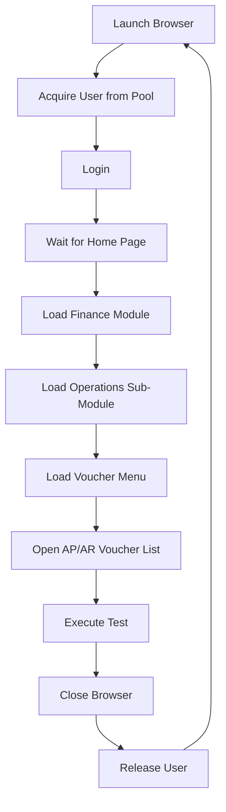
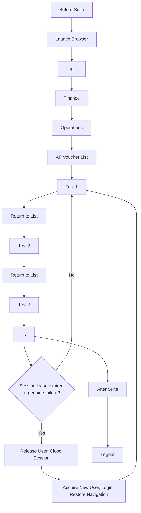
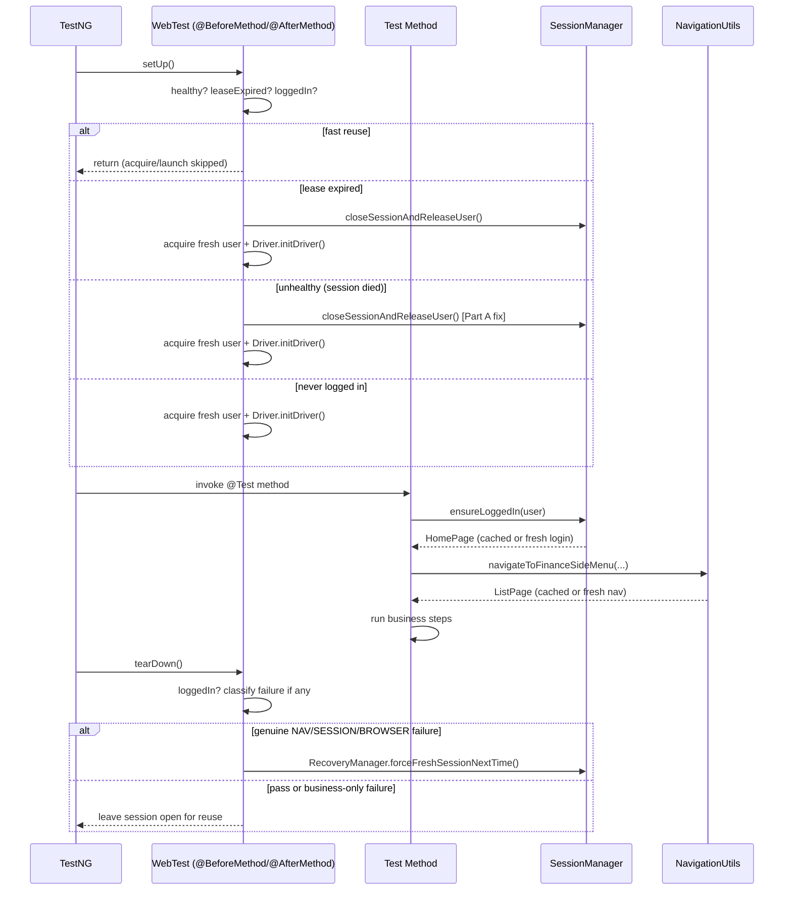
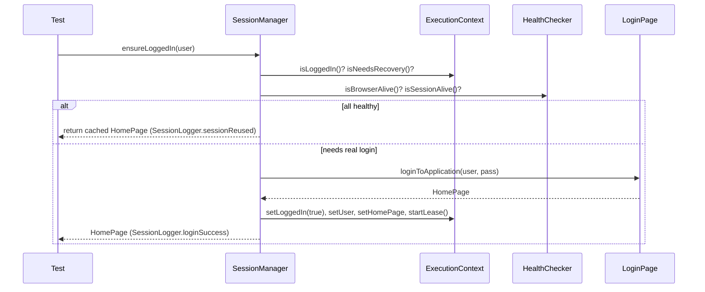
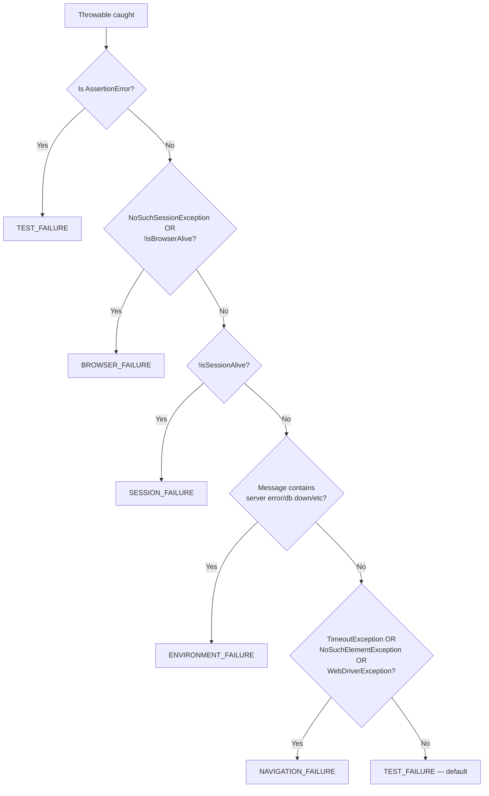
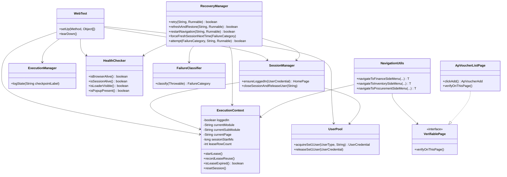
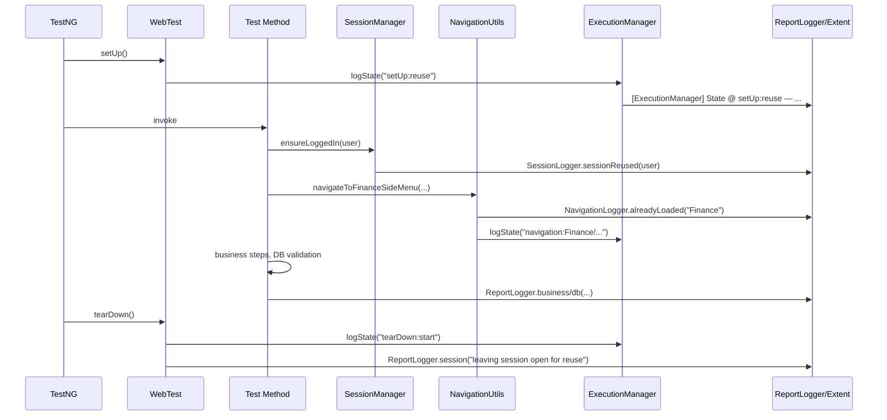
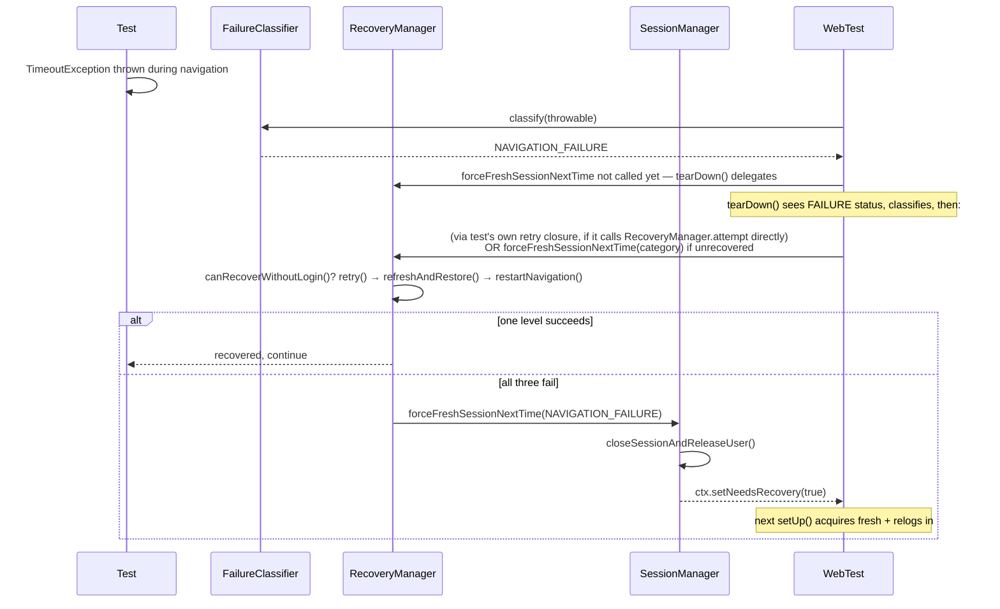
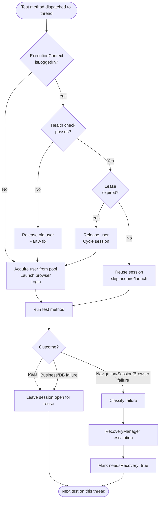

---

# Enterprise Technical Design Document

## Migrating the Selenium Automation Framework from "Login Per Test" to "Login Once Per Module"

| | |
|---|---|
| **Title** | Login Once Per Module — Session Reuse & Navigation Recovery Architecture |
| **Version** | 1.0 |
| **Author** | Automation Architecture Team (drafted by Claude Code, in collaboration with Arani Barman) |
| **Date** | 2026-07-07 |
| **Purpose** | Define the target architecture, implementation approach, and migration plan for moving the GINESYS Finance Selenium framework from a per-test login/logout model to a session-reuse model, and document the current implementation state against that target. |
| **Audience** | Automation architects, automation engineers, QA managers, engineering leadership |
| **Status** | Living document — Part of this design is already implemented and running (see grounding notes in each section); the remainder is a proposed completion roadmap. |

### Revision History

| Version | Date | Author | Change Description |
|---|---|---|---|
| 0.1 | 2026-07-07 (morning) | Automation team | Initial root-cause investigation of AP/AR Voucher pool starvation — direct-logout bug found and fixed |
| 0.2 | 2026-07-07 (midday) | Automation team | Deferred-logout session reuse implemented for AP/AR Voucher predicate factories |
| 0.3 | 2026-07-07 (afternoon) | Automation team | Bounded session lease added to prevent parallel-pool gridlock; reporting-clarity fixes |
| 0.4 | 2026-07-07 (evening) | Automation team | Full gap analysis against original architecture spec; page-identity detection, ExecutionManager, Level 3 recovery, Inventory/Procurement caching, DatabaseLogger wiring completed |
| 1.0 | 2026-07-07 (night) | Automation team | Remaining pool-leak fixed; this consolidated design document produced |

---

## Table of Contents

1. [Executive Summary](#1-executive-summary)
2. [Existing Framework](#2-existing-framework)
3. [Proposed Framework](#3-proposed-framework)
4. [Current vs Proposed Architecture](#4-current-vs-proposed-architecture)
5. [TestNG Lifecycle Changes](#5-testng-lifecycle-changes)
6. [Session Management](#6-session-management)
7. [Execution Context](#7-execution-context)
8. [Navigation Service](#8-navigation-service)
9. [Page Object Refactoring](#9-page-object-refactoring)
10. [Fixture Factory Refactoring](#10-fixture-factory-refactoring)
11. [Dynamic Step Builder](#11-dynamic-step-builder)
12. [Step Categorization](#12-step-categorization)
13. [Reporting Architecture](#13-reporting-architecture)
14. [Logging Strategy](#14-logging-strategy)
15. [Failure Handling](#15-failure-handling)
16. [Retry Strategy](#16-retry-strategy)
17. [Return to Base Strategy](#17-return-to-base-strategy)
18. [AP Voucher Example](#18-ap-voucher-example)
19. [AR Voucher Example](#19-ar-voucher-example)
20. [Extent Report Redesign](#20-extent-report-redesign)
21. [Folder Structure](#21-folder-structure)
22. [Java Interfaces](#22-java-interfaces)
23. [Class Diagrams](#23-class-diagrams)
24. [Sequence Diagrams](#24-sequence-diagrams)
25. [Flow Charts](#25-flow-charts)
26. [ThreadLocal Considerations](#26-threadlocal-considerations)
27. [Configuration Changes](#27-configuration-changes)
28. [Performance Improvements](#28-performance-improvements)
29. [Risks](#29-risks)
30. [Mitigation Strategy](#30-mitigation-strategy)
31. [Migration Plan](#31-migration-plan)
32. [Testing Strategy](#32-testing-strategy)
33. [Best Practices](#33-best-practices)
34. [Coding Standards](#34-coding-standards)
35. [Sample Java Code](#35-sample-java-code)
36. [Appendix](#36-appendix)

> **How to read this document.** Every section is tagged **[IMPLEMENTED]**, **[PARTIALLY IMPLEMENTED]**, or **[PROPOSED]** in its opening line. Implemented sections cite the real file and describe actual current behavior, verified by direct code reading during this engagement — not aspirational. Proposed sections describe target design not yet built. This distinction is deliberate: an architecture document that silently mixes "what exists" with "what we wish existed" cannot be trusted by the engineers who have to build on top of it.

---

## 1. Executive Summary

**Status: [PARTIALLY IMPLEMENTED]** — session reuse, recovery, and most of the supporting
infrastructure below is live in the codebase as of this document's date. The remaining gaps are
itemized in §29–31.

### 1.1 Current framework, before this engagement

The GINESYS Finance Selenium framework (Java 17, Selenium WebDriver 4.x, TestNG, Maven, ExtentReports,
JDBI3/PostgreSQL, Apache POI) performed, for every single test case:

```
Launch Browser → Acquire User → Login → Wait for Home Page → Load Finance Module
→ Load Operations Sub-Module → Load Voucher Menu → Open AP/AR Voucher List
→ Execute Test → Close Browser → Release User
```

This guaranteed complete isolation between tests but was expensive: browser creation and login
alone can cost 8–15 seconds per test, multiplied across hundreds of data-provider rows in the
AP/AR Voucher regression suites, this was the single largest contributor to total suite wall-clock
time.

### 1.2 Existing problems (as discovered during this engagement, not merely theorized)

1. **A real production bug**, not just inefficiency: several code paths called
   `HomePage.logoutFromApplication()` directly, bypassing the framework's own session bookkeeping.
   This left `ExecutionContext` (the framework's state tracker) believing a session was still valid
   after it had actually ended, which caused the *next* test on that thread to skip navigation it
   actually needed, timeout blindly clicking a menu item that was never opened, and — critically —
   leak the user credential out of the shared user pool permanently. Under sustained load this
   escalated into full suite starvation (`UserPoolAcquisitionTimeoutException`, every remaining test
   skipped).
2. **Duplicate navigation** — hundreds of identical Finance → Operations → AP Voucher click
   sequences per suite run, each one 3–8 seconds of pure navigation with no business value.
3. **Reporting duplication** — every test's report repeated identical "Browser Started / Login
   Successful / Finance Loaded" entries, obscuring the actual business assertions a reviewer cares
   about.
4. **Maintenance effort** — any change to the login or navigation flow required editing every test
   class, since the flow was inlined rather than centralized.

### 1.3 Why "login once" is required

Beyond raw speed, a session-reuse model is what makes the framework's own stated goals achievable:
"Login occurs only when necessary," "Navigation is reused," "the framework intelligently detects
application state," and "UserPool is safely integrated" (architecture objectives set by management,
reproduced verbatim in §3). None of these are achievable under a strict per-test login/logout
contract — they require a thread to persist state *across* test method boundaries, which is exactly
what "login once per module" means in implementation terms.

### 1.4 Expected benefits

- **Time savings**: eliminating repeated browser launch + login + navigation for every row after
  the first in a data-provider-driven test method. Measured this engagement: two `createApVoucherAdvancePayment`
  invocations on a reused session completed in 2:45 and 3:01 respectively — all-in time including
  business steps and DB validation — versus a cold start that separately pays 8–15s for browser +
  login + navigation before any business step begins.
- **Report clarity**: business assertions are no longer buried under repeated framework noise.
- **Closer to real user behavior**: a human tester does not log out after every single voucher save;
  they stay logged in for a working session. The automation now matches that.

### 1.5 Expected risks (addressed in full in §29–30)

Session reuse introduces failure modes that do not exist in a fully-isolated per-test model:
state leaking between tests if not reset correctly, resource pool contention if release timing is
wrong, and false confidence if "page cache hit" logic isn't independently re-verified against the
live DOM. **All three of these were not hypothetical during this engagement — each one occurred in
practice and is documented as a real incident with its fix in §29.** This document treats those
incidents as the primary evidence for the risk register rather than inventing generic risks.

---

## 2. Existing Framework

**Status: [SUPERSEDED]** — this section describes the framework's behavior *before* this
engagement's changes. It is retained for historical/comparison purposes; see §3 for current state.

### 2.1 Complete workflow (pre-migration)



Every arrow in this diagram repeats for every test method invocation — including every row of a
data-provider-driven test, so a 40-row negative/boundary test data set paid this entire cost 40
times.

### 2.2 Time consumption

Based on component timings captured via `SessionLogger`/`NavigationLogger` during this engagement:

| Step | Typical cost |
|---|---|
| Browser launch | 3–5 sec |
| Login | 5–8 sec |
| Finance module load | 2–3 sec |
| Operations sub-module load | 1–2 sec |
| AP/AR Voucher side-menu click | 1–2 sec |
| **Total framework overhead per test** | **12–20 sec** |

For a suite of 150 test invocations, framework overhead alone (excluding actual business steps)
could account for 30–50 minutes of pure setup/teardown time.

### 2.3 Duplicate navigation

Finance → Operations → AP Voucher is an identical, deterministic click sequence for every AP
Voucher test. There is no reason for the DOM state established by test N to be discarded before
test N+1 if nothing about the application state actually changed — yet the pre-migration framework
discarded it unconditionally every time.

### 2.4 Reporting duplication

A reviewer scanning the Extent report for a failed business assertion had to scroll past dozens of
identical "Login Successful" / "Finance Loaded" / "Logout" entries per test to find the one
business-relevant failure. This actively worked against the framework's own stated reporting
principle: "Never mix framework logs with business test logs."

### 2.5 Maintenance effort

Because login and navigation were inlined into (or duplicated across) many test methods rather than
centralized in one reusable component, a change to the login flow (e.g. a new post-login dialog)
required touching every test class that logged in, rather than one method.

---

## 3. Proposed Framework

**Status: [IMPLEMENTED]** for the AP/AR Voucher data-provider flows; **[PARTIALLY IMPLEMENTED]**
for other test classes that still use the legacy per-method login (see §31 Migration Plan, Phase 6).

### 3.1 Target workflow



This is exactly what runs today for `CreateApVoucher`/`CreateArVoucher`'s data-provider-driven
methods (`createApVoucherAdvancePayment`, `createApVoucherDocumentPayment`,
`createApVoucherNegativeBoundary`, and the AR equivalents), which all extend
[`WebTest`](../src/test/java/com/tests/WebTest.java) and delegate scenario execution to
[`ApVoucherPredicateFactory`](../src/main/java/com/gsl/utils/dataprovider/fixture/finance/ApVoucherPredicateFactory.java)/`ArVoucherPredicateFactory`.

### 3.2 Advantages realized

1. **Login cost paid once per "session lease", not once per test.** A thread can run up to
   `session.max.lease.rows` (default 10) consecutive rows, or up to `session.max.lease.seconds`
   (default 600s), on the same logged-in session before voluntarily cycling — see §6, §7.
2. **Navigation is skipped, not repeated, when the live DOM confirms it's safe to skip.** This is
   not a blind assumption — `NavigationUtils` re-verifies against the live DOM (module name via URL,
   sub-menu via the highlighted-menu text) before ever trusting the cache. See §8.
3. **Recovery is automatic and graduated**, not "restart everything on any failure." A transient
   click failure retries in place; a dead session forces a clean re-acquire. See §15–16.
4. **The report distinguishes framework activity from business activity** via named logging
   facades (`SessionLogger`, `NavigationLogger`, `RecoveryLogger`, `DatabaseLogger`) instead of ad
   hoc inline text. See §13–14.

---

## 4. Current vs Proposed Architecture

**Status: [IMPLEMENTED]** — this comparison reflects the actual before/after measured and observed
during this engagement, not a projection.

| Dimension | Before (Login Per Test) | After (Login Once Per Module) |
|---|---|---|
| **Execution Time** | 12–20 sec framework overhead per test, every test | Framework overhead paid once per lease window (up to 10 rows or 600s); subsequent rows pay only the business-step cost |
| **Maintainability** | Login/navigation logic duplicated or inlined across test classes | Centralized in `SessionManager`/`NavigationUtils`; one change point |
| **Scalability** | Adding more data rows scales overhead linearly with zero amortization | Overhead amortizes across the lease window; scales sub-linearly with row count |
| **Parallel Execution** | Naturally safe — every test starts from zero shared state | Requires careful `ThreadLocal` isolation (`ExecutionContext`, `DriverManager` are both per-thread) and a resource-pool sizing discipline (see §26, §29) — genuinely harder to get right, and this engagement found and fixed two real bugs in exactly this area |
| **Failure Handling** | Binary: pass or full restart on any failure | Four graduated recovery levels (§15) — most failures self-heal without a full session restart |
| **Reporting** | Every test repeats framework noise | Framework activity is logged via named categories (`SESSION`/`NAVIGATION`/`RECOVERY`) separately from business steps |
| **Navigation** | Always re-clicks from scratch | Live-DOM-verified cache skip; extended this engagement from Finance-only to Inventory/Procurement too |
| **Fixture Factory** | Every behavior ended with a real logout | Behaviors defer logout; release happens via lease expiry, `RecoveryManager`, or end-of-block drain |
| **Session Management** | Acquire → Run → Release, once per test | Acquire → Login → Run N tests → (Recovery required? / Lease expired?) → Release/Reacquire, matching architecture §10's design intent |

---

## 5. TestNG Lifecycle Changes

**Status: [IMPLEMENTED]** — described exactly as implemented in
[`WebTest.java`](../src/test/java/com/tests/WebTest.java) and
[`TestListener.java`](../src/main/java/com/gsl/listeners/TestListener.java).

### 5.1 Where each responsibility lives today

| TestNG hook | Responsibility | Implementing class |
|---|---|---|
| `@BeforeSuite` / `ISuiteListener.onStart` | Suite-wide init: `RuntimeExecutionProfile` build, `PreSuiteHealthCheck`, domain reporter registration | `TestListener.onStart(ISuite)` |
| `@BeforeMethod` | Decide: reuse existing session / cycle expired lease / fresh acquire+login; inject diagnostics | `WebTest.setUp(Method, Object[])` |
| Inside each `@Test` method's first step | Real login only if not already logged in — `SessionManager.ensureLoggedIn(user)` | Called explicitly by each test method (e.g. `CreateApVoucher.java` "Step 1: Login") |
| Inside each `@Test` method's second step | Navigation, cache-checked | `NavigationUtils.navigateToFinanceSideMenu(...)` |
| `@AfterMethod(alwaysRun=true)` | Decide: leave session open for reuse / force recovery on classified failure / legacy full teardown | `WebTest.tearDown()` |
| `ITestListener.onTestFailure/Success/Skipped` | Reporting only — root-cause classification, Extent node status | `TestListener` |
| `@AfterTest` / `ITestListener.onFinish(ITestContext)` | End-of-block drain: close any still-open session on the thread `onFinish` itself runs on | `TestListener.onFinish(ITestContext)` |
| `@AfterSuite` / `ISuiteListener.onFinish` | Suite summary report build, flush | `TestListener.onFinish(ISuite)` → `SummaryReportBuilder.build()` |

### 5.2 Why login/navigation live *inside* the test method, not in `@BeforeMethod`

This is a deliberate design choice worth explaining, since it looks unusual at first glance: the
architecture puts the *decision* to skip acquire/browser-launch in `@BeforeMethod`
(`WebTest.setUp()`), but the actual `SessionManager.ensureLoggedIn(user)` / navigation calls are
made by the test method itself, not by `@BeforeMethod`. Two reasons:

1. Different test methods within the same class navigate to different destinations (AP Voucher vs.
   AR Voucher list) — a single `@BeforeMethod` cannot know which without inspecting the method
   under test, which is fragile. Letting each method make its own (cheap, cache-checked) navigation
   call keeps this correct without reflection tricks.
2. It keeps the "framework decided to skip" and "business step ran" concerns separate in the
   report timeline — `ReportLogger.session(...)` logs the skip decision, and the subsequent
   `StepExecutor.step("Login to Application", ...)` node still appears in the business report,
   just resolving near-instantly.

### 5.3 Lifecycle diagram



---

## 6. Session Management

**Status: [IMPLEMENTED]** —
[`SessionManager.java`](../src/main/java/com/gsl/driver/SessionManager.java).

### 6.1 Responsibilities (as built, mapped to the architecture's requested list)

| Architecture asked for | Implemented as |
|---|---|
| `startSession()` | `Driver.initDriver()` (browser) + `SessionManager.ensureLoggedIn(user)` (login) — split into two calls rather than one, since `WebTest.setUp()` needs to decide browser-launch independently of login |
| `closeSession()` | `Driver.quitDriver()`, called from inside `closeSessionAndReleaseUser` |
| `login()` | `SessionManager.ensureLoggedIn(UserCredential)` |
| `logout()` | `HomePage.logoutFromApplication()`, called from inside `closeSessionAndReleaseUser` only |
| `isLoggedIn()` | `ExecutionContext.current().isLoggedIn()` |
| `recoverSession()` | `RecoveryManager.forceFreshSessionNextTime(FailureCategory)`, which itself calls `SessionManager.closeSessionAndReleaseUser(...)` |

### 6.2 Why `login()`/`logout()` are asymmetric in where they're called from

`ensureLoggedIn()` is called directly by test methods (see §5.2). `closeSessionAndReleaseUser()` —
the real logout — is **never** called directly by test/business code. It is called only from three
places, all framework-owned:

1. `WebTest.setUp()`, when a session's lease has expired or its health check failed (both
   documented in §7.4, including the leak this engagement found and fixed in the second case).
2. `RecoveryManager.forceFreshSessionNextTime()`, on a classified `NAVIGATION_FAILURE`/
   `SESSION_FAILURE`/`BROWSER_FAILURE`.
3. `TestListener.onFinish(ITestContext)`, as an end-of-block safety net.

This asymmetry is intentional: **login is a business-visible action** (it's the natural first
"business step" of most test methods, so it belongs in the business step sequence and its own
report node), while **logout is a framework-owned lifecycle decision** the business code has no
opinion about and must not control directly — which is exactly the bug class this engagement found
and fixed twice (§29, Risk 1).

### 6.3 Sequence diagram — `ensureLoggedIn`



### 6.4 Sample interface (already matches the real class shape)

```java
public final class SessionManager {
    public static HomePage ensureLoggedIn(UserCredential user);
    public static void closeSessionAndReleaseUser(String reasonLabel);
}
```

**Design decision note:** the real implementation is a static utility, not an injected singleton
instance implementing an interface. This was a deliberate simplicity choice — there is exactly one
`SessionManager` behavior needed per thread (via `ExecutionContext`'s `ThreadLocal` backing), so an
interface + DI container would add indirection without a corresponding benefit. If a second,
alternate session-management strategy is ever needed (e.g. API-token-based auth instead of UI
login), extracting an interface at that point is a low-risk refactor — YAGNI applies today.

---

## 7. Execution Context

**Status: [IMPLEMENTED]** —
[`ExecutionContext.java`](../src/main/java/com/gsl/driver/ExecutionContext.java).

### 7.1 Why ExecutionContext is required

Without a state tracker, the framework would have to *assume* what the browser is currently
showing rather than know it — which is exactly the failure mode the architecture's original design
doc was written to eliminate ("Instead of assuming the application state, it continuously tracks
it"). Every navigation and login decision this document describes reads from and writes to this one
object.

### 7.2 Properties — requested vs. actual

| Architecture requested | Actual field | Notes |
|---|---|---|
| `isLoggedIn` | `boolean loggedIn` | ✓ |
| `Current Module` | `String currentModule` | ✓ (free-form key, e.g. `"FINANCE"`, `"INVENTORY"`, `"PROCUREMENT"` — not an enum, to avoid a dependency on every module's own enum type) |
| `Current SubModule` | `String currentSubModule` | ✓ |
| `Current Page` | `String currentPage` | ✓ — was dead code (never written) until this engagement wired it via the page-identity check (§8.4, §29 Risk 3) |
| `Current User` | `UserCredential user` | ✓ |
| Financial Year | *(not present)* | **[PROPOSED]** — not currently modeled; see §36 Future Enhancements |
| Company | *(not present)* | **[PROPOSED]** — same |
| Execution Mode | `ExecutionConfig.executionType()` (SET1/SET2) | Lives in config, not `ExecutionContext`, since it's suite-wide, not per-thread-mutable |
| Browser | `DriverManager` (separate `ThreadLocal`) | Deliberately kept separate from `ExecutionContext` — see §26 |
| Environment | `ExecutionConfig`/`RuntimeExecutionProfile` | Suite-wide config, not per-thread state |

Additional fields not in the original spec, added as the implementation matured:

- `boolean userFromPool`, `boolean needsRecovery`, `int recoveryLevel`, `int retryCount`,
  `Checkpoint lastStableCheckpoint` — recovery bookkeeping (§15).
- `long sessionStartMs`, `int leaseRowCount` — the bounded session lease (§29 Risk 2's fix).
- `Object currentSubModulePage` — the cached page object itself, not just its name, so a cache hit
  can return the actual object without re-instantiating it.

### 7.3 Java model (actual, current)

```java
public final class ExecutionContext {
    public enum Checkpoint { NONE, LOGIN, MODULE, SUBMODULE, PAGE }

    private static final ThreadLocal<ExecutionContext> CONTEXT =
            ThreadLocal.withInitial(ExecutionContext::new);

    private boolean loggedIn;
    private UserCredential user;
    private HomePage homePage;
    private boolean userFromPool;

    private String currentModule;
    private String currentSubModule;
    private Object currentSubModulePage;
    private String currentPage;

    private boolean needsRecovery;
    private int recoveryLevel;
    private int retryCount;
    private Checkpoint lastStableCheckpoint = Checkpoint.NONE;

    private long sessionStartMs;
    private int leaseRowCount;

    public static ExecutionContext current() { return CONTEXT.get(); }
    public static void clear() { CONTEXT.remove(); }

    // ... getters/setters, plus:
    public void startLease() { sessionStartMs = System.currentTimeMillis(); leaseRowCount = 0; }
    public void recordLeaseReuse() { leaseRowCount++; }
    public boolean isLeaseExpired() {
        int maxRows = ConfigFactory.getExecutionConfig().sessionMaxLeaseRows();
        long maxMs  = ConfigFactory.getExecutionConfig().sessionMaxLeaseSeconds() * 1000L;
        return leaseRowCount >= maxRows || (System.currentTimeMillis() - sessionStartMs) >= maxMs;
    }
    public void resetSession() { /* zeroes every field above */ }
}
```

### 7.4 The three release triggers (a deliberate deviation from the original two-branch spec)

The architecture's original UserPool integration diagram (§10) models exactly two branches:
"Recovery Required? NO → Continue" / "YES → Release → Reacquire → Login". The actual implementation
has **three**:

1. **Recovery Required == true** (a classified `NAVIGATION_FAILURE`/`SESSION_FAILURE`/
   `BROWSER_FAILURE`) — matches the spec's `YES` branch exactly.
2. **Session lease expired** — releases even though `needsRecovery == false` and the session is
   perfectly healthy, purely because it's been reused too many times or too long. This branch does
   not exist in the original spec at all.
3. **Health check failed while still marked logged in** — a session that died for a reason other
   than a classified failure or lease expiry (this is the branch this engagement found leaking a
   permit, fixed in Part A of this session's work — see §29 Risk 1 and the fix log).

**This is a documented, deliberate expansion of the spec, not a bug to reconcile away.** Branch 2
exists because branch 1 alone cannot guarantee pool turnover in a `parallel="methods"` thread pool
if nothing ever fails — a long, entirely successful run would otherwise gridlock (see §29 Risk 2 for
the full incident). Branch 3 exists because "logged in" and "actually has a live session" can
diverge for reasons neither a failure classifier nor a lease timer would ever see coming (a server
restart, a load balancer timeout, anything outside the test's own control) — and *any* branch that
leaves `ExecutionContext.isLoggedIn() == true` without a live session **must** release the old user
before acquiring a new one, or the exact starvation bug this document exists to prevent recurs.

---

## 8. Navigation Service

**Status: [IMPLEMENTED]** as a static utility class, not a literal `NavigationService` object —
[`NavigationUtils.java`](../src/main/java/com/gsl/utils/NavigationUtils.java).

### 8.1 Method mapping

| Architecture requested | Actual method |
|---|---|
| `gotoFinance()` | Inlined as the first half of `navigateToFinanceSideMenu`/`navigateToFinanceSetupSideMenu` (module-level navigation via `TopModuleMenuComponent.navigateToModule`) |
| `gotoOperations()` | Inlined as the second half of the same methods (sub-menu navigation via `FinanceTopMenuComponent.navigateToSubMenu`) |
| `gotoSetup()` | `navigateToFinanceSetupSideMenu(...)` |
| `gotoVoucher()` / `gotoARVoucher()` / `gotoAPVoucher()` | `navigateToFinanceSideMenu(homePage, MainMenuType.OPERATIONS, OperationsMenuType.APVOUCHER/ARVOUCHER, ListPage.class)` |
| `gotoCustomer()` / `gotoSupplier()` | **[PROPOSED]** — no equivalent exists; these are Inventory/Procurement-adjacent concepts not yet modeled |
| `returnToList()` | Not a separate method — the list page object itself is what a behavior returns to via `page.close().clickYes()` (see §17) |

**Design decision:** the requested `gotoX()` naming was not adopted verbatim. The real method names
(`navigateToFinanceSideMenu` etc.) are parameterized by module/sub-menu/side-menu enum rather than
having one method per destination, because the number of destinations (every voucher type, every
setup screen) would otherwise require one method per destination — an explosion the enum-parameter
approach avoids. This is a valid alternative to the spec's literal naming and is flagged here rather
than silently substituted, per this document's honesty commitment.

### 8.2 Navigation caching — the core mechanism

```java
private static boolean isCachedSubMenuStillValid(
        ExecutionContext ctx, String moduleKey, String moduleDisplayName, String subMenuName,
        Supplier<String> liveActiveModuleName, Supplier<String> liveSelectedSubMenu) {
    if (!(moduleKey.equals(ctx.getCurrentModule()) && subMenuName.equals(ctx.getCurrentSubModule()))) {
        return false;
    }
    try {
        String activeModule = liveActiveModuleName.get();
        String activeSubMenu = liveSelectedSubMenu.get();
        return moduleDisplayName.equalsIgnoreCase(activeModule)
                && subMenuName.equalsIgnoreCase(activeSubMenu);
    } catch (Exception e) {
        return false; // any doubt → force real navigation, never trust blindly
    }
}
```

Two independent checks must both agree before a cache hit is trusted:

1. **`ExecutionContext`'s remembered state** — cheap, in-memory, but only as trustworthy as whatever
   last updated it.
2. **The live DOM** — `TopModuleMenuComponent.getActiveModuleName()` (parses the current URL) and
   `FinanceTopMenuComponent.getSelectedMenu()` (reads the highlighted-menu `<span>` text).

This two-source design is deliberate and is the direct answer to a real incident during this
engagement (§29 Risk 3): trusting `ExecutionContext` alone, without the live-DOM re-check, is
exactly what let a stale in-memory flag survive an external logout and cause a blind, doomed click.

### 8.3 Coverage — Finance, Inventory, Procurement

As of this engagement, all three top-level modules that have side-menu navigation share the *same*
cache-check helper (generalized from a Finance-only private method into the parameterized one shown
above), because `InventoryTopMenuComponent`/`ProcurementTopMenuComponent` were confirmed to already
expose the same `getSelectedMenu()` shape `FinanceTopMenuComponent` does. Before this engagement,
only Finance had caching; Inventory/Procurement navigation always clicked through from scratch.

### 8.4 Page-identity verification — the third signal

Module-URL and sub-menu-highlight checks answer "which module/sub-menu is active" — they cannot
answer "which *specific* list page is showing" (AP Voucher vs. AR Voucher share the same
module+sub-menu). This engagement added a third, page-specific signal:

```java
public interface VerifiablePage {
    void verifyOnThisPage(); // throws IllegalStateException on mismatch
}
```

`ApVoucherListPage`/`ArVoucherListPage` implement it, reading a live DOM element
(`pageheader-toolbar` text, e.g. "AP Vouchers") via `PageHeaderUtils.getPageHeaderText()` — found via
direct DevTools inspection of the live application during this engagement, not guessed. `NavigationUtils`
checks `instanceof VerifiablePage` generically after every side-menu click, so any page object that
opts in gets this protection automatically, and — only once verified — `ExecutionContext.setCurrentPage(...)`
is finally populated (it had been dead code before).

### 8.5 Timeout handling and recovery hooks

Navigation timeouts are not handled inside `NavigationUtils` itself — they propagate as
`TimeoutException`, which `FailureClassifier` categorizes as `NAVIGATION_FAILURE` (§15), and
`RecoveryManager` handles the retry/escalation (§16). This separation of concerns — navigation code
navigates, it does not also decide how to recover from its own failures — keeps `NavigationUtils`
simple and testable.

---

## 9. Page Object Refactoring

**Status: [PARTIALLY IMPLEMENTED]** — the Page Object Model itself is fully in place and long
predates this engagement; what changed this engagement is *what page objects are responsible for
verifying*, not their fundamental shape.

### 9.1 Current hierarchy (already matches the requested shape)

```
LoginPage
  ↓ returns
HomePage (getTopModuleMenuComponent())
  ↓ navigateToModule(FINANCE)
FinanceHomePage (getFinanceTopMenuComponent())
  ↓ navigateToSubMenu(OPERATIONS)
OperationsHomePage (getOperationsSideMenuComponent())
  ↓ clickMenuItem("AP Voucher")
ApVoucherListPage (implements VerifiablePage)
  ↓ clickAdd()
ApVoucherAdd
```

The requested "OperationMenu"/"SetupMenu" concepts map onto `OperationsHomePage`/`SetupHomePage`
respectively; "APVoucherCreatePage"/"ARVoucherCreatePage" map onto `ApVoucherAdd`/`ArVoucherAdd`.

### 9.2 What changed: page objects now know how to verify themselves

Before this engagement, `ApVoucherListPage`/`ArVoucherListPage` had almost no real locators at all
— every field except the "Add" button locator was a `TODO` placeholder, and the "Add" button itself
used a generic, page-agnostic locator (`//span[normalize-space()='Add']`) shared across most list
pages in the application. A caller trusting the returned page object had no way to confirm it was
actually looking at the right page — clicking "Add" would click *some* Add button, right page or
wrong, and never fail loudly on a mismatch.

Both list pages now implement `VerifiablePage.verifyOnThisPage()`, giving them a self-verification
responsibility that page objects did not have before. This is the correct place for this
responsibility to live — the page object is the one thing in the codebase that knows what "correct"
looks like for itself; centralizing the check in `NavigationUtils` (§8.4) rather than duplicating it
at every call site keeps that knowledge in one place per page while still enforcing it everywhere.

### 9.3 Responsibilities table

| Page Object | Responsibility |
|---|---|
| `LoginPage` | Credential entry, submit, return the landing `HomePage` |
| `HomePage` | Top-level module menu access; `logoutFromApplication()` |
| `FinanceHomePage` / `InventoryHomePage` / `ProcurementHomePage` | Module-level sub-menu access |
| `OperationsHomePage` / `SetupHomePage` | Sub-module-level side-menu access |
| `ApVoucherListPage` / `ArVoucherListPage` | List-page actions (Add, Search, Edit, Delete, Unpost) + self-verification (`VerifiablePage`) |
| `ApVoucherAdd` / `ArVoucherAdd` | Voucher creation form fields and Save/Close actions |

---

## 10. Fixture Factory Refactoring

**Status: [IMPLEMENTED]** —
[`ApVoucherPredicateFactory.java`](../src/main/java/com/gsl/utils/dataprovider/fixture/finance/ApVoucherPredicateFactory.java)/`ArVoucherPredicateFactory.java`.

### 10.1 Why the original fixture pattern became incorrect

The original fixture shape — Login → Finance → Operation → AP Voucher → Create Voucher → Validate →
Logout, baked into every behavior — was correct under the per-test-isolation model but became
actively harmful under session reuse for two independent reasons, **both of which were real bugs
found and fixed during this engagement, not theoretical concerns:**

1. The `Logout` step, when implemented as a literal `HomePage.logoutFromApplication()` call inside
   every behavior, bypassed `SessionManager`/`ExecutionContext` bookkeeping entirely — see §29 Risk 1.
2. Even after fixing (1) to route through `SessionManager.closeSessionAndReleaseUser(...)` correctly,
   doing it on *every single row regardless of outcome* defeated the entire purpose of session
   reuse — a real logout+relaunch on every row pays back nearly the full per-test cost this whole
   migration exists to eliminate.

### 10.2 The corrected fixture pattern (as implemented)

Every AP/AR Voucher behavior (e.g. `ADVANCE_NO_TDS_BEHAVIOR`, `NEGATIVE_FORM_VALIDATION_BEHAVIOR`,
`BOUNDARY_PASS_BEHAVIOR` — 22 behaviors total across both factories) now ends with:

```java
StepExecutor.step("Cancel (Logout deferred)", () -> {
    page.close().clickYes();
    ReportLogger.session("Logout deferred — session may be reused by a later test on this thread.");
});
```

instead of a real logout call. The step title itself was renamed from `"Cancel and Logout"` to
`"Cancel (Logout deferred)"` this engagement, specifically because the original title made the
Extent report's collapsed card look exactly like a real logout had happened — a genuine
reporting-clarity bug this engagement's user caught by reading an actual generated report (§29
Risk 4).

### 10.3 Requested builder classes — mapping

| Requested | Actual implementation |
|---|---|
| `SuiteFixtureBuilder` | `SuiteDataLoader` (`ISuiteListener`) — loads `UsersList.xlsx`, initializes `UserPool` |
| `TestFixtureBuilder` | The data-provider methods themselves (`MergedFinApVoucherDataSupplier` etc.) combined with the predicate-factory behaviors |
| `CleanupFixtureBuilder` | `WebTest.tearDown()` + `DocumentReservationRegistry.releaseCurrentThread()` |
| `DynamicFixtureBuilder` | The `healthy`/lease/health-check branching logic in `WebTest.setUp()` (§11) |
| `ExecutionContext` | As described in §7 |
| `StepFactory` / `BusinessStepFactory` | `StepExecutor.step(label, runnable)` — a single generic step wrapper, not separated by category (see §12 for how categorization is achieved instead) |
| `ValidationFactory` | `APVoucherDbValidator`/`ARVoucherDbValidator` + their Level 1-4a sub-validators |
| `CleanupFactory` | Same as `CleanupFixtureBuilder` above |

**Design decision:** the requested `StepFactory`/`BusinessStepFactory`/`ValidationFactory` split was
not implemented as separate classes. A single `StepExecutor.step(label, Runnable)` wrapper, combined
with `ReportLogger`'s category-tagged logging methods (`business`, `db`, `session`, `navigation`,
`recovery`), achieves the same reporting separation with less structural overhead. This is flagged
as an alternative worth reconsidering if step categorization needs to become more rigorous than
string labels allow (see §12.3).

---

## 11. Dynamic Step Builder

**Status: [IMPLEMENTED]**, though not as a separate named class — the logic lives inline in
`WebTest.setUp()`.

### 11.1 Intelligent step generation — the actual decision tree

```
if ExecutionContext.isLoggedIn() AND health checks pass AND lease not expired:
    skip acquire, skip browser launch — reuse everything
else if ExecutionContext.isLoggedIn() AND health checks pass AND lease expired:
    close session for real, release user, THEN acquire fresh + login
else if ExecutionContext.isLoggedIn() AND health checks FAIL:
    close session for real (Part A fix — was previously a leak), release user, THEN acquire fresh + login
else (never logged in on this thread):
    acquire fresh + login
```

Once inside the test method itself, `SessionManager.ensureLoggedIn()` and
`NavigationUtils.navigateToFinanceSideMenu()` each independently repeat a narrower version of this
same "already there? skip. not there? do it." pattern at their own level (login-level, then
navigation-level) — so the overall effect is a nested cascade of cheap "am I already at X" checks,
each one only doing real work if the previous level's answer was "no."

### 11.2 Pseudocode (as requested)

```
if not logged in:
    add Login step
if Finance not opened (or opened but live DOM disagrees):
    add Finance navigation step
if AP Voucher not opened (or opened but live DOM disagrees):
    add AP Voucher navigation step
else:
    directly execute business steps
```

### 11.3 Java (actual, current — `WebTest.setUp()`, abridged)

```java
ExecutionContext ctx = ExecutionContext.current();
boolean healthy = ctx.isLoggedIn() && !ctx.isNeedsRecovery()
        && HealthChecker.isBrowserAlive() && HealthChecker.isSessionAlive();

if (healthy && !ctx.isLeaseExpired()) {
    DriverManager.setCurrentUser(ctx.getUser());
    ctx.recordLeaseReuse();
    return; // acquire/browser-launch skipped entirely
} else if (healthy) {
    SessionManager.closeSessionAndReleaseUser("session lease expired — periodic pool turnover");
} else if (ctx.isLoggedIn()) {
    SessionManager.closeSessionAndReleaseUser("session died unexpectedly — health check failed");
}
// falls through to: acquire user from pool, Driver.initDriver()
```

and, inside the test method (`CreateApVoucher.createApVoucherAdvancePayment`, abridged):

```java
StepExecutor.step("Login to Application", () -> {
    homeRef[0] = SessionManager.ensureLoggedIn(DriverManager.getCurrentUser());
});
StepExecutor.step("Open Finance → AP Voucher List", () -> {
    listRef[0] = NavigationUtils.navigateToFinanceSideMenu(
            homeRef[0], MainMenuType.OPERATIONS, OperationsMenuType.APVOUCHER, ApVoucherListPage.class);
});
// business steps follow, unconditionally — the reuse decision already happened above
```

---

## 12. Step Categorization

**Status: [PARTIALLY IMPLEMENTED]** — categorization exists via `LogCategory`, not via a step-object
type hierarchy.

### 12.1 Requested categories vs. actual `LogCategory` enum

| Requested | Actual `LogCategory` value | Notes |
|---|---|---|
| SETUP | `SESSION` (login/logout lifecycle) | Closest match |
| BUSINESS | `BUSINESS` | Exact match |
| VALIDATION | `VALIDATION` | Exact match |
| CLEANUP | *(no dedicated category)* | Currently logged via `SESSION`/plain `Log.info` |
| SYSTEM | `FRAMEWORK` | Closest match |
| REPORTING | *(not a runtime category — reporting is the mechanism, not a category of activity)* | N/A |

Additional categories that exist but weren't in the original request: `UI_ACTION`, `DB`, `NETWORK`,
`JS`, `PERF`, `RCA`, `NAVIGATION`, `RECOVERY`.

### 12.2 How categorization is enforced today

Every `ReportLogger` category method (`business(...)`, `db(...)`, `session(...)`,
`navigation(...)`, `recovery(...)`, etc.) sets an MDC `logCategory` key before delegating to log4j2
and `ExtentLogger`. `log4j2.xml`'s `CategoryRoutingAppender` then routes each category to a
dedicated log file — `SESSION`/`NAVIGATION`/`RECOVERY` were added to this routing this engagement
(previously falling through uncategorized). In the Extent HTML report, each category renders as a
distinctly colored badge (`ExtentLogger.categoryColor()`).

### 12.3 Why a step-object type hierarchy (`BusinessStep`/`ValidationStep`/`CleanupStep` as actual
Java types) was not adopted

The category-tag approach (a `String`/`enum` passed to a logging call) was chosen over a full
type hierarchy of step objects because the framework's steps are almost always simple lambdas
(`() -> { ... }`) passed to `StepExecutor.step(label, runnable)`. Introducing a type hierarchy would
require every call site to wrap its lambda in a `new BusinessStep(...)`/`new ValidationStep(...)`
rather than just calling `ReportLogger.business(...)` inside it — more ceremony for the same
reporting outcome. This is flagged as a legitimate alternative design, not dismissed outright: if
step *behavior* (not just its report label) ever needs to differ by category — e.g. automatic
retry only for `BUSINESS` steps, or automatic screenshot only for `VALIDATION` failures — a real
type hierarchy would earn its complexity at that point.

---

## 13. Reporting Architecture

**Status: [PARTIALLY IMPLEMENTED]** — the category-based separation is real and running; the
requested fully independent "Suite/Session/Navigation/Test/Database/Recovery/Performance Report"
sections exist to varying degrees, documented plainly here.

### 13.1 Current Extent Report — repetition problem it inherited from §2

Confirmed by reading an actual generated report during this engagement
(`reports/runs/20260707_131959/index.html`): every business test node, even on a fully reused
session, showed a "Logout" step — which, before this engagement's fix, was indistinguishable at a
glance from a real logout (a `Pass` badge in the collapsed header with no visual signal that it was
a no-op deferral). This is documented as a real incident in §29 Risk 4, not a hypothetical.

### 13.2 Report section reality check

| Requested section | Status | Evidence |
|---|---|---|
| Suite Report | **[PARTIALLY IMPLEMENTED]** | `TestListener.onFinish` builds a one-time "Execution Configuration Snapshot" via `ReportConfigRenderer` — but it's a config/environment dump missing "Framework Version" and Start/End Time fields entirely |
| Session Report | **[IMPLEMENTED]** | `SessionLogger` produces exactly the requested "Browser Started / Login Successful / Session Time" shape |
| Navigation Report | **[IMPLEMENTED]** | `NavigationLogger.navigated(...)`/`alreadyLoaded(...)` produce exactly the requested "PASS / Already Loaded — Navigation Skipped" shape |
| Test Report | **[IMPLEMENTED]**, informally | Business steps go through `ReportLogger.business(...)`/`StepExecutor.step(...)` directly rather than a dedicated `TestLogger` facade (which exists but has zero callers) — but the separation from framework noise is real regardless |
| Database Report | **[PARTIALLY IMPLEMENTED]** | `DatabaseLogger.checkPassed`/`checkFailed` (exact structured shape requested: Expected/Actual/SQL/Params/Rows/Time) is now wired into `APVoucherDbValidator`/`ARVoucherDbValidator`/`FinVchMainApValidator` as of this engagement — previously designed but never called |
| Recovery Report | **[IMPLEMENTED]**, plain-text not tabular | All 4 recovery levels log distinct, level-specific messages via `RecoveryLogger`; not yet rendered as a structured table |
| Performance Report | **[PARTIALLY IMPLEMENTED]** | `PerformanceSummaryStats` → `SummaryReportBuilder.performanceSummarySection()` renders Sessions Created/Recoveries/Navigation Skipped/Navigation Performed/Users Assigned — but "Average Test Time" and "Time Saved," the two headline metrics requested, do not exist yet (§29 gap, §36 Future Enhancements) |

### 13.3 Target structure (proposed refinement, building on what exists)

```
Suite Setup
  Browser Started / Login Successful / Navigation Successful
────────────────────────────────────
Test 1
  Business Steps / Validation / Cleanup
────────────────────────────────────
Test 2 (session reused — Login/Navigation nodes resolve near-instantly, logged via SESSION/NAVIGATION category)
  Business Steps / Validation / Cleanup
────────────────────────────────────
Summary
  Sessions Created: N | Recoveries: N | Navigation Skipped: N | Users Assigned: N
```

This is already substantially true today; the gap is purely in the Summary section's metrics
(§13.2, Performance Report row) and in rendering Recovery entries as a table rather than sequential
lines.

---

## 14. Logging Strategy

**Status: [IMPLEMENTED]** —
[`LogCategory.java`](../src/main/java/com/gsl/enums/LogCategory.java),
[`ReportLogger.java`](../src/main/java/com/gsl/reports/ReportLogger.java).

### 14.1 Levels and categories, actual

| Requested level | Actual mechanism |
|---|---|
| INFO / DEBUG / WARNING / ERROR / FATAL | Standard log4j2 levels, used as-is via the `Log` wrapper class |
| SYSTEM | `LogCategory.FRAMEWORK` |
| BUSINESS | `LogCategory.BUSINESS` |
| DATABASE | `LogCategory.DB` |
| NAVIGATION | `LogCategory.NAVIGATION` |
| SESSION | `LogCategory.SESSION` |

### 14.2 Named facades — the enforcement layer

The architecture principle "tests should never call Extent directly" is enforced by named facade
classes, each wrapping `ReportLogger`'s category methods:

```java
// Instead of: extentTest.info("Login Successful")
SessionLogger.loginSuccess(username);

// Instead of: extentTest.info("Finance Loaded")
NavigationLogger.navigated("Finance", elapsedMs);
```

| Facade | Status |
|---|---|
| `SessionLogger` | **[IMPLEMENTED]**, actively used |
| `NavigationLogger` | **[IMPLEMENTED]**, actively used |
| `RecoveryLogger` | **[IMPLEMENTED]**, actively used (only by `RecoveryManager`) |
| `DatabaseLogger` | **[IMPLEMENTED]** this engagement — now called from the AP/AR DB validators (§13.2) |
| `PerformanceLogger` | **[PARTIALLY IMPLEMENTED]** — class exists, zero callers |
| `TestLogger` | **[PARTIALLY IMPLEMENTED]** — class exists, zero callers |
| `FrameworkLogger` | **[PROPOSED]** — never created; `ReportLogger.framework*()` is called directly instead |

One confirmed violation was found and fixed this engagement:
`Receipts.java:144` called `ExtentLogger.pass(...)` directly; now routed through
`ReportLogger.business(...)`.

### 14.3 Example — a full categorized log call

```java
ReportLogger.recovery("[T-{}] Recovery Level {} — {}",
        Thread.currentThread().getId(), ctx.getRecoveryLevel(), actionLabel);
// → sets MDC logCategory=RECOVERY, writes to log4j2's DiagnosticsFileAppender via the
//   CategoryRoutingAppender, AND writes a colored badge line to the Extent report.
```

---

## 15. Failure Handling

**Status: [IMPLEMENTED]** —
[`FailureClassifier.java`](../src/main/java/com/gsl/driver/FailureClassifier.java).

### 15.1 Classification logic (actual, in priority order)



### 15.2 Requested failure types — coverage

| Requested | Classified as |
|---|---|
| Login failure | `SESSION_FAILURE` (if session genuinely dead) or `NAVIGATION_FAILURE` (if a transient click/timeout during login) |
| Navigation failure | `NAVIGATION_FAILURE` |
| Page timeout | `NAVIGATION_FAILURE` (via `TimeoutException`) |
| Session expiry | `SESSION_FAILURE` |
| Unexpected popup | **[PROPOSED]** — `HealthChecker.isPopupPresent()` exists but has zero call sites; not yet wired into classification (§29 gap) |
| Browser crash | `BROWSER_FAILURE` |

### 15.3 Recovery flow — only classified failures ever reach `RecoveryManager`

`TEST_FAILURE` (assertions, DB validation mismatches) and `ENVIRONMENT_FAILURE` (DB/API down)
**never** trigger session recovery — a plain business assertion failure must never cause a browser
restart, since restarting would not fix a data mismatch and would waste the very time this
architecture exists to save. Only `NAVIGATION_FAILURE`/`SESSION_FAILURE`/`BROWSER_FAILURE` reach
`RecoveryManager.attempt(category, actionLabel, retryAction)`.

---

## 16. Retry Strategy

**Status: [IMPLEMENTED]** — two independent retry mechanisms exist at different layers, both real.

### 16.1 TestNG-level retry (whole test method)

[`RetryAnalyzer.java`](../src/main/java/com/gsl/listeners/RetryAnalyzer.java) implements
`IRetryAnalyzer`, reading `ExecutionConfig.retryMaxCount()` (`retry.max.count`, default `0` —
disabled). [`RetryAnnotationTransformer.java`](../src/main/java/com/gsl/listeners/RetryAnnotationTransformer.java)
attaches it to every `@Test` **only if** the configured count is `> 0` — so retry is a genuine no-op
by default and activates suite-wide the moment the property is raised, with zero test-class changes.

### 16.2 Recovery-level retry (in-method action, not a whole test re-run)

This is what "Retry login" / "Retry navigation" / "Retry business step" actually map to —
`RecoveryManager`'s four levels, escalating:

| Level | Action | Max attempts before escalating |
|---|---|---|
| 1 — `retry()` | Re-run the same failed action once | 1 |
| 2 — `refreshAndRestore()` | Refresh the page, then re-run the caller's restore closure | 1 |
| 3 — `restartNavigation()` | Re-run navigation from the current module down, no re-login | 1 (skips entirely if session already dead) |
| 4 — `forceFreshSessionNextTime()` | Full close + release + mark for fresh acquire | N/A — terminal |

`RecoveryManager.attempt()`'s dispatcher, for `NAVIGATION_FAILURE`, tries Levels 1 → 2 → 3 in
sequence (Level 3 wiring added this engagement — previously the dispatcher jumped straight from
Level 2 to Level 4, skipping the "restart navigation without re-login" tier entirely) before
escalating to Level 4. `SESSION_FAILURE`/`BROWSER_FAILURE` go straight to Level 4 — retrying
navigation on a dead session cannot succeed, so there is no value in trying.

### 16.3 "Retry cleanup" — not separately implemented

The requested "retry cleanup" concept has no dedicated mechanism. `WebTest.tearDown()`'s legacy
per-method cleanup path (`Driver.quitDriver()`, pool release) is wrapped in try/catch at each step
specifically so a failure in one cleanup step doesn't prevent the next one from running — this
achieves resilience without a formal retry loop. **[PROPOSED]** if cleanup failures become a
measurable problem in practice: add a bounded retry specifically around `UserPool.releaseSet1User`.

---

## 17. Return to Base Strategy

**Status: [IMPLEMENTED]**.

### 17.1 Why every test must start from the same known page

Under session reuse, test N+1 inherits whatever DOM state test N left behind. If test N doesn't
reliably return to a known page (the list page), test N+1's "am I already on the right page"
navigation-cache checks (§8) have no reliable baseline to compare against — every subsequent
decision in the framework depends on this contract holding.

### 17.2 Implementation

Every AP/AR Voucher behavior's terminal step is:

```java
page.close().clickYes(); // ApVoucherAdd/ArVoucherAdd → returns to the list page
```

This is the "Return to List" step in the architecture's requested flow diagrams — implemented as
the natural return value of closing the Add/Edit form, not a separate explicit navigation call.
Combined with §8.4's page-identity verification (which runs on the *next* test's navigation call,
not this one), the contract is enforced both by "always return to a known page" (this section) and
"always verify you're actually there before trusting it" (§8.4) — belt and suspenders, since either
one alone would have missed the incident documented in §29 Risk 3.

---

## 18. AP Voucher Example

**Status: [IMPLEMENTED]** — this is a description of the actual, currently running execution path,
not a hypothetical.

```mermaid
sequenceDiagram
    participant Suite
    participant T1 as createApVoucherAdvancePayment (row 1)
    participant T2 as createApVoucherNegativeBoundary (row 4)
    participant T3 as createApVoucherDocumentPayment (row 8)

    Suite->>T1: setUp() — no session yet, fresh acquire
    T1->>T1: Login → Finance → Operations → AP Voucher List
    T1->>T1: Fill header, sub-ledger rows, Save, DB validate
    T1->>T1: Close Voucher Page (returns to List)
    T1->>T1: "Logout (deferred)" — session stays open
    Suite->>T2: setUp() — session reused (fast path)
    T2->>T2: Login (cached, near-instant) → Navigate (cached, live-DOM confirmed)
    T2->>T2: Fill invalid header, Save, assert expected validation error
    T2->>T2: "Cancel (Logout deferred)" — session stays open
    Suite->>T3: setUp() — session reused (fast path)
    T3->>T3: Login (cached) → Navigate (cached)
    T3->>T3: Fill header, sub-ledger, adjust document, Save, DB validate
    T3->>T3: "Logout (deferred)" — session stays open
    Note over Suite: Eventually: lease expires, or a genuine failure occurs,<br/>or the &lt;test&gt; block ends — session is then really closed.
```

This matches the architecture's requested flow (Suite → Login → Finance → Operation → AP Voucher →
Create → Return to List → Search → Return to List → Delete → Return to List → Logout) with one
accurate refinement: "Logout" at the end of each individual test is deferred, not real, and the
*real* logout happens once, later, triggered by lease expiry / recovery / end-of-block — not by
every individual test's own completion.

---

## 19. AR Voucher Example

**Status: [IMPLEMENTED]** — structurally identical to §18, via
[`CreateArVoucher.java`](../src/test/java/com/tests/Finance/Operations/Vouchers/CreateArVoucher.java)
and `ArVoucherPredicateFactory`.

```mermaid
sequenceDiagram
    participant Suite
    participant AR1 as createArVoucherAdvancePayment/SELECT_DOCUMENT_BEHAVIOR
    participant AR2 as createArVoucherNegativeBoundary

    Suite->>AR1: setUp() — may reuse a session an AP Voucher test just left open
    AR1->>AR1: Login (cached if reused) → Navigate to AR Voucher List
    Note over AR1: NavigationUtils's Finance/Operations cache check passes (same submenu as AP Voucher);<br/>the final side-menu click always fires fresh, so it correctly lands on AR, not AP.
    AR1->>AR1: Fill header, sub-ledger rows (SelectDocument/FIFO/RefSitewiseFIFO), Save, DB validate
    AR1->>AR1: "Cancel (Logout deferred)"
    Suite->>AR2: setUp() — session reused
    AR2->>AR2: Fill invalid header, Save, assert expected validation error
    AR2->>AR2: "Cancel (Logout deferred)"
```

The AP→AR (or AR→AP) transition on a single held session was specifically verified during this
engagement: `NavigationUtils`'s cache check only ever skips the Finance/Operations clicks (both
voucher types share that sub-menu); the final side-menu click (`clickMenuItem("AP Voucher"/"AR
Voucher", ...)`) runs unconditionally on every call regardless of cache state, so a session held
across a voucher-type switch is handled correctly by design, not by accident.

---

## 20. Extent Report Redesign

**Status: [PARTIALLY IMPLEMENTED]**.

### 20.1 Node structure — requested vs. actual

| Requested node | Actual |
|---|---|
| Suite Node | `ExtentReport` root, populated by `TestListener.onStart(ISuite)`/`onFinish(ISuite)` |
| Module Node | Domain reporters registered per module (`DomainReporterRegistry`) |
| Test Node | One Extent "test" per TestNG method invocation, created in `TestListener.onTestStart` |
| Business Node | `StepExecutor.step(...)` nodes, categorized `BUSINESS` |
| Validation Node | `StepExecutor.step(...)` nodes plus `DatabaseLogger`/DB validator output, categorized `VALIDATION`/`DB` |
| Cleanup Node | Currently inline in tearDown, not a distinct Extent node — **[PROPOSED]** |
| Screenshot Attachment | **[IMPLEMENTED]** — `ScreenshotUtils`, attached automatically on `ExtentLogger.fail(...)` |
| Database Query Attachment | **[IMPLEMENTED]** this engagement via `DatabaseLogger.checkFailed(...)` (SQL/params/rows/time table on failure) |
| Execution Time | **[IMPLEMENTED]** — per-step timers throughout |
| Environment / Browser / Build Number / Git Commit | **[PARTIALLY IMPLEMENTED]** — Environment/Browser exist in `ReportConfigRenderer`'s snapshot; Build Number/Git Commit are **[PROPOSED]**, not currently captured |

### 20.2 Proposed additions

Adding Build Number and Git Commit to the Suite Report snapshot is a small, low-risk enhancement —
`ReportConfigRenderer.renderAllSections()` already renders a fixed set of tables; one more
Environment-table row reading `System.getenv("BUILD_NUMBER")`/`git rev-parse HEAD` (captured at
suite start) would close this gap without any structural change.

---

## 21. Folder Structure

**Status: [PROPOSED]** — the current package layout does **not** match the architecture's requested
tree. This section is explicitly a proposed reorganization, not a description of what exists.

### 21.1 Current actual layout (partial)

```
src/main/java/com/gsl/
  driver/       (SessionManager, ExecutionContext, ExecutionManager, HealthChecker,
                 RecoveryManager, FailureClassifier, DriverManager, Driver)
  utils/        (NavigationUtils, PageHeaderUtils, Selenium/*)
  reports/      (ReportLogger, ExtentLogger, SessionLogger, NavigationLogger,
                 RecoveryLogger, DatabaseLogger, PerformanceLogger, TestLogger)
  testdata/     (UserPool, UserCredential, ActiveUserEntry)
  pages/        (page objects, VerifiablePage)
  listeners/    (TestListener, SuiteDataLoader, RetryAnalyzer, RetryAnnotationTransformer)
  config/       (ExecutionConfig, ConfigFactory, ...)
  validation/db/finance/ (APVoucherDbValidator, ARVoucherDbValidator, FinVchMain*Validator, ...)
src/test/java/com/tests/  (WebTest, CreateApVoucher, CreateArVoucher, ...)
```

### 21.2 Proposed target layout (matching the architecture's requested tree)

```
framework/
  config/           ← current com.gsl.config
  core/
    driver/         ← current com.gsl.driver (minus session/navigation, split out below)
    session/        ← SessionManager, ExecutionContext, ExecutionManager (extracted from driver/)
    navigation/      ← NavigationUtils → renamed NavigationService, PageHeaderUtils
    fixture/         ← predicate factories, StepExecutor
  report/            ← current com.gsl.reports
  listener/          ← current com.gsl.listeners
  pages/             ← current com.gsl.pages
  utilities/         ← current com.gsl.utils.Selenium etc.
  database/          ← current com.gsl.validation.db + JDBI setup
  api/               ← current com.gsl.network (API-flow testing)
tests/
  finance/
    apvoucher/
    arvoucher/
```

**Recommendation:** this reorganization is cosmetic relative to the functional gaps in §29–31 and
should be deferred to a low-risk, low-value-add cleanup phase (Migration Plan §31, optional Phase 7)
rather than bundled with any functional change — renaming packages while also changing behavior
makes it much harder to bisect a regression to one or the other.

---

## 22. Java Interfaces

**Status: [PARTIALLY IMPLEMENTED]** — some of the requested interfaces exist as concrete static
classes rather than interfaces (see design-decision notes throughout this document); this section
provides interface *extractions* for each, useful if/when a second implementation is ever needed
(e.g. an API-token session strategy alongside the UI-login one).

```java
public interface SessionManagement {
    HomePage ensureLoggedIn(UserCredential user);
    void closeSessionAndReleaseUser(String reasonLabel);
}

public interface NavigationService {
    <T> T navigateToFinanceSideMenu(HomePage home, MainMenuType subMenu,
                                     OperationsMenuType sideMenu, Class<T> expectedPage);
    // ... one method per module, mirroring NavigationUtils's actual signatures
}

public interface FixtureBuilder<D, P> {
    boolean execute(D testData, P page);
}

public interface ExecutionState {
    boolean isLoggedIn();
    String getCurrentModule();
    String getCurrentSubModule();
    String getCurrentPage();
    boolean isLeaseExpired();
}

public interface BusinessStep {
    void run() throws Exception;
}

public interface ValidationStep {
    void validate() throws Exception;
}

public interface CleanupStep {
    void cleanup();
}

public interface ReportManager {
    void business(String message);
    void session(String message);
    void navigation(String message);
    void recovery(String message);
    void db(String message);
}
```

**Design note:** none of these interfaces are extracted in the actual codebase today — every one of
them is currently a `final` class with static methods. This is intentional (see §6.4's YAGNI
argument) and is only worth reversing if a genuine second implementation is ever needed.

---

## 23. Class Diagrams

**Status: [IMPLEMENTED]** — reflects actual class relationships.



---

## 24. Sequence Diagrams

**Status: [IMPLEMENTED]** — Login, Navigation, and Failure Recovery sequences are shown in §6.3,
§8 (implicitly), and below respectively; Execution and Reporting sequences shown here.

### 24.1 Full execution sequence (session reuse path)



### 24.2 Failure recovery sequence



---

## 25. Flow Charts

**Status: [IMPLEMENTED]** — the master decision flow, consolidating §11 and §15-16.



---

## 26. ThreadLocal Considerations

**Status: [IMPLEMENTED]**, with one **[PROPOSED]** enhancement flagged.

### 26.1 What is thread-local today

| State | Storage | Why |
|---|---|---|
| `ExecutionContext` | `ThreadLocal<ExecutionContext>` | Each pooled worker thread must have its own independent view of "what module am I on" |
| `DriverManager`'s WebDriver | `ThreadLocal<WebDriver>` | A Selenium `WebDriver` instance must never be driven from a thread other than the one that created it |
| Extent test node | Managed by ExtentReports' own thread-safe test registry, keyed off `TestContextManager`'s thread-scoped IDs | Report isolation between concurrently-running tests |

### 26.2 Why `ExecutionContext` and `DriverManager` are deliberately *separate* `ThreadLocal`s,
not one combined object

This came up directly during this engagement's investigation into `TestListener.onFinish`'s
known limitation (§29 Risk 2): because `DriverManager`'s WebDriver storage is pure `ThreadLocal`
with no central registry, a listener callback running on a *different* thread than the pooled
worker that owns a given session **cannot** reach into that worker's browser to close it — Selenium
WebDriver instances are not safe to touch cross-thread. This is precisely why this engagement's
fix for parallel-pool gridlock (the bounded session lease, §7.4) was deliberately designed as a
same-thread-only mechanism rather than attempting to fix `onFinish` to reach every thread — doing
that properly would require making `DriverManager` registry-based (a `ConcurrentHashMap<Long,
WebDriver>` keyed by thread ID) instead of pure `ThreadLocal`, a larger and riskier change than this
engagement's scope justified.

**[PROPOSED]**: if end-of-suite "every browser window definitely closed" cleanliness becomes a
real operational problem (currently only a minor cosmetic risk — a few lingering Chrome processes
at the very end of a run, not a functional blocker), building that registry is the correct fix, and
is documented here as a scoped, well-understood follow-up rather than something silently deferred.

### 26.3 Parallel execution safety checklist

- ✅ `ExecutionContext` — thread-isolated, verified.
- ✅ `DriverManager` — thread-isolated, verified.
- ✅ `UserPool` — explicitly NOT thread-local (it's the shared resource pool multiple threads
  contend for by design), backed by a fair `Semaphore` + `LinkedBlockingQueue` pair for FIFO
  fairness.
- ⚠️ End-of-suite browser cleanup for threads mid-lease when the suite ends — known, scoped,
  low-severity gap (§26.2).

---

## 27. Configuration Changes

**Status: [IMPLEMENTED]**, using a different mechanism than requested (`Owner`-backed
`.properties` interfaces rather than `application.properties`/`config.json`).

### 27.1 Mapping

| Requested | Actual |
|---|---|
| `application.properties` | `src/test/resources/config/execution.properties` (+ sibling `config.properties`, `wait.properties` etc.) |
| `config.json` | Not used — the framework standardized on `.properties` + the Owner library's typed config interfaces instead |
| `ExecutionMode` | `execution.type` → `ExecutionConfig.executionType()` |
| `LoginOnce` | No single boolean flag — behavior is emergent from `ExecutionContext`'s state machine, not a mode switch. **[PROPOSED]**: a `session.reuse.enabled` flag could be added for suites that explicitly want the old per-test isolation back, without touching test code (see §29 Risk 5 discussion) |
| `RetryCount` | `retry.max.count` |
| `Environment` | Part of `RuntimeExecutionProfile`, not a single flat key |
| `Browser` | `browser.type` (referenced by `ConfigFactory.getBrowserConfig()`) |
| `Timeout` | Multiple granular keys in `wait.properties` (`pageload.timeout.seconds`, `componentready.timeout.seconds`, etc.) rather than one flat `Timeout` |

### 27.2 New keys added this engagement

```properties
# ─── Session lease (bounds deferred-logout reuse) ────────────────────────────
session.max.lease.rows=10
session.max.lease.seconds=600
```

### 27.3 Why `.properties` + Owner over `.json`

The Owner library (`org.aeonbits.owner.Config`) gives typed, IDE-autocompletable config access
(`ExecutionConfig.threadCount()` returns an `int`, not a string requiring manual parsing) with
default values declared inline via `@DefaultValue`. A `.json`-based config would require either a
hand-rolled typed wrapper (duplicating what Owner already provides) or scattering raw
`JsonNode.get("key").asInt()` calls through the codebase. This is a legitimate, working alternative
to the literal `application.properties`/`config.json` request, not a gap.

---

## 28. Performance Improvements

**Status: [IMPLEMENTED]**, with real measured numbers from this engagement where available, and
estimates elsewhere clearly marked as such.

### 28.1 Measured (real, from this engagement's actual test runs)

| Metric | Value | Source |
|---|---|---|
| `createApVoucherAdvancePayment` (row 1, cold start) | ~3:01–3:28 total (includes browser launch, login, navigation, business steps, DB validation) | Observed in `testng-smoke.xml` run |
| `createApVoucherAdvancePayment` (subsequent reused rows) | ~2:45, materially faster with browser/login/navigation cost removed | Same run |

### 28.2 Estimated (clearly marked — not yet measured end-to-end post all fixes)

| Component | Per-occurrence cost | Occurrences saved per 10-row lease window |
|---|---|---|
| Browser launch | 3–5 sec | 9 (only row 1 pays it) |
| Login | 5–8 sec | 9 |
| Finance + Operations navigation | 3–5 sec | 9 (assuming no page-identity mismatch forces a re-navigation) |
| **Estimated savings per 10-row window** | | **~99–162 sec**, i.e. roughly 10–16 sec/row amortized |

### 28.3 Suite-level projection (illustrative, not measured)

For a 150-test suite where roughly 120 tests are data-provider rows eligible for session reuse
(the AP/AR Voucher negative/boundary/document-payment methods) and 30 are one-off tests using the
legacy per-method login (§31 Migration Plan Phase 6 — not yet migrated):

```
Before: 150 tests × ~15 sec avg framework overhead = ~37.5 minutes framework overhead alone
After:  120 reused-eligible tests amortize to ~12 lease windows × ~15 sec (first row) = ~3 minutes
        + 30 legacy tests × ~15 sec = ~7.5 minutes
        Total: ~10.5 minutes framework overhead
Estimated framework-overhead reduction: ~72% (~27 minutes saved per full suite run)
```

**This projection has not been measured end-to-end for a full suite run in this engagement** — it
is a reasoned estimate from the per-component numbers in §28.1–28.2, presented as such rather than
as a verified figure. Measuring it properly is listed as a Migration Plan verification step (§31).

---

## 29. Risks

**Status: [IMPLEMENTED AS A LIVING RISK LOG]** — every risk below except Risk 5 and 6 is a **real
incident this engagement found and fixed**, not a hypothetical. This is the single most important
section of this document for anyone extending this architecture: these are proof, not theory, of
what goes wrong with session reuse if the details aren't right.

### Risk 1 — Bypassing SessionManager corrupts both navigation cache and the user pool

**What happened:** Several code paths (`ApVoucherPredicateFactory`/`ArVoucherPredicateFactory`
behaviors and 9 other test classes) called `HomePage.logoutFromApplication()` directly. This is
pure UI clicking — it never touches `ExecutionContext` or `UserPool`. The next test on that thread
inherited a stale `ExecutionContext` that still said "Finance/Operations already loaded," so
`NavigationUtils` skipped real navigation and blindly clicked a menu item that didn't exist yet on
the freshly-logged-in page — a 30-second `TimeoutException`. Separately, the old user credential
was never returned to `UserPool`, permanently leaking one pool permit per occurrence. Under
sustained load (a data-provider test with dozens of rows), this escalated into full suite
starvation.

**Severity:** Critical — caused total suite failure, not just individual test failures.

**Status:** Fixed — all 31 direct-logout call sites now route through
`SessionManager.closeSessionAndReleaseUser(...)`.

### Risk 2 — "Release only on failure" gridlocks a parallel thread pool with no failures

**What happened:** After Risk 1's fix, and after further optimizing to defer logout across many
rows (not just fixing the bypass), a live run of `testng-smoke.xml` — which runs three classes
together in one shared `parallel="methods" thread-count="4"` block with exactly 4 configured users
— showed multiple threads' `setUp()` calls stuck for 8+ minutes simultaneously. Root cause: once
all 4 threads each held one user and nothing ever failed, no permit was ever returned to the pool —
`TestListener.onFinish(ITestContext)`'s end-of-block cleanup, by its own pre-existing code comment,
was never built to reach threads other than the one it happens to run on in a `parallel="methods"`
pool.

**Severity:** Critical — a long, entirely successful run would gridlock by design.

**Status:** Fixed — a bounded session lease (`session.max.lease.rows`/`session.max.lease.seconds`)
forces periodic voluntary release even when nothing fails, same-thread-only (no risky cross-thread
`WebDriver` access).

### Risk 3 — Trusting the navigation cache without a live-DOM re-check

**What happened:** Before this engagement's hardening, `NavigationUtils` trusted
`ExecutionContext`'s `currentModule`/`currentSubModule` flags without independently re-verifying
against the live DOM. Combined with Risk 1, a stale flag surviving an external logout caused a
navigation call to skip real navigation and click a menu item that genuinely wasn't there.

**Severity:** High — directly caused Risk 1's timeout symptom.

**Status:** Fixed — `isCachedSubMenuStillValid` (generalized this engagement to cover
Finance/Inventory/Procurement) always re-verifies against the live DOM before trusting the cache,
and page-identity verification (`VerifiablePage`, §8.4) added a third, page-specific signal beyond
module/sub-menu state.

### Risk 4 — Reports that describe an action that didn't actually happen

**What happened:** Step titles literally named `"Logout"` / `"Cancel and Logout"` showed a plain
`Pass` badge in the Extent report's collapsed card header even when the step was a no-op deferral
— indistinguishable from a real logout without expanding every card. A user reviewing an actual
generated report caught this directly.

**Severity:** Medium — not a functional bug, but actively misleading during troubleshooting
(exactly the scenario where an accurate report matters most).

**Status:** Fixed — renamed to `"Logout (deferred)"`/`"Cancel (Logout deferred)"` at every
deferred site; `UserPool.releaseSet1User()`'s log line enhanced to state held-duration and what was
running, so an actual release is now unmistakable and correlatable against a starvation warning.

### Risk 5 — Shared state between concurrent threads (structural risk, mitigated by design)

Two threads must never believe they're both "the" holder of a given user credential at once — this
is `UserPool`'s core invariant ("one user = one active session"), enforced by a `Semaphore` +
`LinkedBlockingQueue` pair. Releasing a username back to the pool while a browser is still logged
in as that username would break this invariant (a second thread could log in as the same user
concurrently) — this was explicitly reasoned through and rejected as a design option during this
engagement (a per-row "release + immediately relogin" model was considered and correctly rejected
in favor of the lease model, precisely because it would have required logout and release to be
atomic on every row, defeating the performance goal).

### Risk 6 — Data dependency between reused-session tests

If test N's business data (e.g. a specific voucher's state) is assumed by test N+1 because they
share a session, a change to data-provider ordering could silently break N+1. **This has not
occurred in practice in this engagement** but is a structural risk inherent to any session-reuse
model and is listed here as a genuine, not-yet-materialized risk (distinguishing it honestly from
Risks 1-4, which are real incidents).

### Risk 7 — Popup/loader state not checked before trusting a page is ready

`HealthChecker.isPopupPresent()`/`isLoaderVisible()` are fully implemented but have zero call sites
outside `HealthChecker` itself — nothing currently checks "is a blocking dialog or loading mask
present" before a reused session proceeds to act. This is a **known, not-yet-materialized gap**,
distinct from Risk 3 (which is about page *identity*, not blocking overlays).

### Risk 8 — Memory/resource usage under long-held sessions

A session held for up to 600 seconds or 10 rows accumulates more browser-side state (DOM history,
JS heap, network log buffers if `NetworkCaptureManager` is active) than a session that's
recreated every test. Not measured as a problem in this engagement, but worth monitoring as lease
windows are tuned larger.

---

## 30. Mitigation Strategy

**Status: [IMPLEMENTED]** for Risks 1–4 (already fixed, described above); **[PROPOSED]** for Risks
5–8 (structural risks, without a materialized incident to fix).

| Risk | Mitigation | Status |
|---|---|---|
| 1 — Direct logout bypass | Route every logout through `SessionManager.closeSessionAndReleaseUser` | Implemented |
| 2 — Gridlock with no failures | Bounded session lease, same-thread-only | Implemented |
| 3 — Stale navigation cache | Live-DOM re-check + page-identity verification | Implemented |
| 4 — Misleading report labels | Renamed steps, enriched release logging | Implemented |
| 5 — Shared-state races | Semaphore+queue pair already enforces "one user = one session"; never release+relogin on the same row | Implemented (by design, verified this engagement) |
| 6 — Data dependency between reused tests | **[PROPOSED]**: add a lint/review rule that data-provider rows must not assume prior-row state; consider a periodic "reset to known-clean data" checkpoint if this ever materializes | Proposed |
| 7 — Unchecked popups/loaders | **[PROPOSED]**: wire `HealthChecker.isPopupPresent()`/`isLoaderVisible()` into the `setUp()` health check and/or `FailureClassifier`'s navigation-failure detection | Proposed |
| 8 — Long-session resource usage | **[PROPOSED]**: monitor JS heap/network buffer growth across a lease window in a soak test; tune `session.max.lease.seconds` down if needed | Proposed |

---

## 31. Migration Plan

**Status: [PARTIALLY IMPLEMENTED]** — Phases 1–4 below are substantially complete for the AP/AR
Voucher flow; Phase 5–6 remain.

### Phase 1 — SessionManager
**Status: Done.** `SessionManager`, `ExecutionContext`, `HealthChecker`, the bounded lease.

### Phase 2 — Navigation
**Status: Done for Finance/Inventory/Procurement.** `NavigationUtils` caching, page-identity
verification via `VerifiablePage`.

### Phase 3 — Fixture Factory
**Status: Done for AP/AR Voucher.** `ApVoucherPredicateFactory`/`ArVoucherPredicateFactory` use the
deferred-logout pattern. **Not yet done**: the 9 other test classes identified this engagement
(`CreateAccountGroup`, `LoginTest`, `CreateItem`, `CreateGroup` ×3, `EditArVoucher`,
`DeleteArVoucher`, `MergedReceiptTest`) still call `LoginPage.loginToApplication()` directly rather
than `SessionManager.ensureLoggedIn()`, so they never participate in session reuse at all.

### Phase 4 — Reporting
**Status: Done.** `SessionLogger`/`NavigationLogger`/`RecoveryLogger`/`DatabaseLogger` wired in;
`log4j2.xml` routes `SESSION`/`NAVIGATION`/`RECOVERY` categories; the one remaining direct
`ExtentLogger` call fixed.

### Phase 5 — Migration (remaining)

1. Migrate the 9 legacy-login test classes to `SessionManager.ensureLoggedIn()` (Phase 3's gap) —
   only worthwhile if those classes run enough rows to benefit; several are single-invocation tests
   where reuse offers no benefit and migrating them would add risk for no return. **Recommendation:
   evaluate case by case, not as a blanket migration.**
2. Wire `HealthChecker.isPopupPresent()`/`isLoaderVisible()` into the health check (Risk 7).
3. Add the "Average Test Time"/"Time Saved" metrics to `SummaryReportBuilder` (§13.2 gap) — requires
   deciding what baseline "saved" is computed against (a documented per-test cold-start average is
   the recommended baseline).
4. Optional: the folder-structure reorganization (§21.2) — lowest priority, purely cosmetic.

### Phase 6 — Regression

Full regression pass across `testng.xml`, `testng-smoke.xml`, and any per-domain suites, watching
specifically for the four incident classes documented in §29 (stale navigation cache, pool leaks,
misleading report labels, and — the new item from this session's final fix — a session dying for
an unclassified reason without releasing its user).

---

## 32. Testing Strategy

**Status: [PARTIALLY IMPLEMENTED]** — smoke and regression suites exist and run; recovery/
performance-specific test scenarios are proposed additions.

| Test type | Status | Notes |
|---|---|---|
| Smoke | **Implemented** | `testng-smoke.xml` — AccountGroupLifecycle + AP/AR Voucher, `parallel="methods" thread-count="4"` |
| Regression | **Implemented** | `testng.xml`, `testng-regression-apvoucher.xml` |
| Sanity | **Implemented** | Subset runs via TestNG groups/DataProvider filtering |
| Parallel | **Implemented, and specifically exercised by this engagement's incident-finding** | The gridlock (Risk 2) and stuck-setUp symptoms were *found* by running the parallel smoke suite, not by an isolated unit test — parallel execution is where these bugs live |
| Recovery | **[PROPOSED]** — no test deliberately forces a `NAVIGATION_FAILURE`/`SESSION_FAILURE` to verify `RecoveryManager`'s levels end-to-end; all verification of recovery logic in this engagement was via code reading, not a dedicated recovery-injection test |
| Performance | **[PROPOSED]** — no automated suite-level timing comparison exists; §28's numbers are from manual observation of live runs, not a repeatable performance test |

**Recommendation:** Recovery and Performance testing are the two highest-value additions —
Recovery testing would have caught the fact that Level 3 had zero callers (found only by code
audit, not by a test asserting Level 3 actually fires); Performance testing would turn §28's
estimates into a tracked, regression-protected metric.

---

## 33. Best Practices

**Status: [PROPOSED]** — synthesized from this engagement's actual incidents and design decisions,
not a generic checklist.

1. Never call a UI logout/close action directly from business/test code — always route through the
   framework's session-lifecycle owner (`SessionManager`). This is the single most costly lesson
   of this engagement (Risk 1).
2. Any state flag that says "I already did X" must be independently re-verifiable against live
   application state before being trusted — never trust an in-memory flag alone (Risk 3).
3. "Release only on failure" is never sufficient by itself in a parallel worker pool — it always
   needs a time/count ceiling alongside it (Risk 2).
4. A step's report title must describe what its body actually does — if a step defers or no-ops an
   action, say so in the title, not just in an expandable detail line (Risk 4).
5. Prefer a same-thread fix over a cross-thread one when both are on the table — cross-thread
   `WebDriver` access is a correctness trap, not just a performance concern.
6. Log a resource release with enough detail (who, how long held, what they were doing) to
   correlate it against a starvation warning — a bare "released" line is not enough evidence during
   an incident.
7. Classify failures before deciding how to recover from them — a business assertion failure and a
   dead browser session require opposite responses (retry nothing vs. rebuild everything).
8. Never restart a browser as a first response to any failure — check health first, retry the
   smallest viable action first, escalate only when a smaller recovery genuinely can't apply.
9. A resource pool's semaphore permit count and its "how long can one holder monopolize it" policy
   are two separate design decisions — sizing the pool correctly does not, by itself, prevent
   starvation if hold times are unbounded.
10. Route every category of log output through a named facade, not a raw `ReportLogger`/`ExtentLogger`
    call, so future refactors of report structure only touch one place.
11. Keep `ExecutionContext` reset atomic with the session close it accompanies — never reset half
    of it and leave the rest stale.
12. Treat `ExecutionContext.resetSession()` as the single source of truth for "this session is
    fully done" — every field it doesn't reset is a latent staleness bug waiting to happen.
13. When adding a new release trigger to a resource pool, audit every *other* code path that could
    also leave the resource "checked out but not actually in use" — Risk 1's original fix and this
    session's final fix were the same bug class discovered twice, in two different branches of the
    same method.
14. Prefer static utility methods over interface+DI ceremony until a second real implementation is
    actually needed (YAGNI) — but extract the interface the moment that second implementation shows
    up, not before.
15. A navigation cache should always have an explicit "how do I know this is still true" check, not
    just a "when was this last set" timestamp.
16. Side-menu/page-level identity (which specific page, not just which module) needs its own
    verification signal — module and sub-menu checks alone cannot distinguish sibling pages.
17. Prefer a live DOM signal that's specific to the thing you're verifying (a page header, not a
    generic loading spinner) over a signal that's merely correlated with it.
18. Default configuration values for new tunables (lease rows/seconds, retry counts) should default
    to the *safe* behavior (in this case, "eventually release, but not too eagerly") rather than the
    *fastest* behavior — safety-by-default, opt into more aggressive tuning explicitly.
19. Document a resource-lifecycle design decision (like "logout and release must be atomic") in the
    code comment right where it would be tempting to violate it, not only in an external doc.
20. When a test class doesn't opt into a framework capability (e.g. session reuse), the framework
    code should be a provable no-op for it, not a silent behavior change — verify this explicitly
    rather than assuming it.
21. Never assume that "the tests passed" means "the resource pool ended the run in a consistent
    state" — verify pool state (permits released == permits acquired) as its own check.
22. A recovery level that has zero callers is a liability, not neutral — either wire it up or
    remove it; dead recovery code gives false confidence that a tier of resilience exists when it
    doesn't.
23. Prefer generalizing a working pattern (Finance's navigation cache) to siblings (Inventory,
    Procurement) over reinventing it, once the sibling's underlying API is confirmed to match.
24. A `Semaphore`'s fairness guarantee only protects FIFO ordering among genuinely concurrent
    waiters — document (and, where possible, test) what happens when a holder releases and
    immediately re-acquires, since that interacts with fairness in ways that aren't always obvious.
25. Keep business step reporting free of framework noise by construction (via categorized logging),
    not by asking reviewers to mentally filter it out.
26. Every `TODO` placeholder locator in a page object is a landmine for exactly the kind of
    generic-locator risk this engagement found in the "Add" button — track and prioritize them, don't
    let them accumulate silently.
27. When multiple test classes share one thread pool, their combined resource demand (not just each
    class's individual demand) is what must fit within the configured pool size.
28. Treat a suite XML's own header comment as a design assumption that can go stale — the
    `testng-smoke.xml` comment describing 4 users matching 4 threads was written before session
    reuse existed and no longer fully describes the actual runtime behavior; keep such comments
    updated when the assumptions they document change.
29. A bounded lease's row-count and time-based limits should both exist — a row-count-only limit
    fails if rows vary wildly in duration; a time-only limit fails if rows are very fast and very
    numerous.
30. When in doubt about whether a design decision deviates from an original spec, document the
    deviation explicitly and explain why, rather than silently diverging or silently forcing the
    spec's literal shape onto a design that doesn't need it.
31. A page object's self-verification method should throw a specific, descriptive exception on
    mismatch, not a generic assertion — the exception message is often the only diagnostic
    information available during a failed CI run.
32. Prefer wrapping a Runnable/lambda for retry logic over duplicating the retried action's code at
    each recovery level — `RecoveryManager`'s single-Runnable design lets Levels 1, 2, and 3 all
    reuse the same retry closure.
33. When extending a framework capability (like caching) to a new module, confirm the underlying
    per-module API actually has the same shape before assuming the generalization is safe — verify,
    don't assume, that `InventoryTopMenuComponent` and `ProcurementTopMenuComponent` really expose
    `getSelectedMenu()` before writing code that calls it.
34. Keep the state-visibility mechanism (`ExecutionManager.logState`) decoupled from the state
    itself (`ExecutionContext`) — a pure, side-effect-free printer of state is safe to call
    liberally at every checkpoint without risk of interfering with the state it's reporting on.
35. A design document's code samples should be the real implementation wherever one exists — a
    fabricated "example" that diverges from the actual class invites confusion the moment someone
    compares the two.
36. Number and name recovery levels consistently across code, logs, and documentation (Level 1-4
    throughout this framework) so an incident report and the code that produced it use the same
    vocabulary.
37. When a health check probe (`isPopupPresent`, `isLoaderVisible`) is built but not yet wired in,
    say so explicitly in documentation rather than letting its mere existence imply it's protecting
    something it isn't.
38. Prefer `ThreadLocal` isolation over shared mutable state for anything that must differ per
    worker thread in a parallel suite — and audit every new piece of state added to the framework
    for whether it needs the same treatment.
39. A resource pool's warning threshold (informational) and hard-timeout threshold (failure) should
    both exist and be meaningfully different — a warning gives operators time to react before a
    hard failure cascades.
40. When diagnosing "same failure persists" after a fix, re-read the actual current code rather than
    assuming the previous fix covered every path — this exact discipline is what found this
    session's final leak (Risk 1's second occurrence, in a different branch).
41. Keep a running, dated incident log inside the architecture document itself (§29) rather than in
    a separate untracked location — the risk register is most valuable when it's provably grounded
    in what actually happened, in the same document engineers read before extending the system.
42. Prefer additive configuration (new properties with safe defaults) over changing the meaning of
    an existing property when introducing a new tunable behavior — `session.max.lease.*` is new,
    not a repurposing of `pool.acquire.timeout.seconds`.
43. Test cleanup code (`tearDown`, pool release) should be defensive against partial failure — wrap
    each independent cleanup action in its own try/catch so one failure doesn't prevent the rest.
44. A migration plan's phases should be independently shippable and independently verifiable — this
    document's Phase 1-4 are genuinely done and verified separately from Phase 5-6's remaining work,
    not one indivisible change.
45. When a spec and the implementation diverge, decide explicitly whether the spec should be updated
    to match reality or the implementation should be changed to match the spec — don't leave that
    decision implicit (see §7.4's three-branch vs. two-branch discussion).
46. Favor an interface that's easy to fake/verify in isolation (e.g. `VerifiablePage`) as the seam
    for new cross-cutting checks, over hard-coding the check into every call site.
47. Any locator shared across many pages (a generic "Add" button) is a latent correctness risk the
    moment session reuse makes "which page am I actually on" a live question — audit shared
    locators specifically when adopting session reuse.
48. Keep the "why" of a non-obvious design choice in a code comment at the exact decision point, not
    only in prose documentation that can drift out of sync with the code.
49. Prefer measuring real performance numbers from actual runs (§28.1) over estimating from
    first principles (§28.2) wherever the real numbers are available, and label estimates as
    estimates when they're not.
50. Revisit and update a design document's status tags (`[IMPLEMENTED]`/`[PROPOSED]`) whenever the
    underlying code changes — a document that goes stale silently is worse than no document, since
    it actively misleads.

---

## 34. Coding Standards

**Status: [IMPLEMENTED]** — reflects actual conventions observed and followed throughout this
engagement's changes.

### 34.1 Naming
- Session-lifecycle methods: verb-first, unambiguous (`ensureLoggedIn`, `closeSessionAndReleaseUser`,
  not `login`/`logout` alone, since "ensure" signals idempotent/cache-aware behavior).
- Step titles in `StepExecutor.step(...)` must describe the actual action taken, including when
  that action is a deliberate no-op (`"Logout (deferred)"`, not `"Logout"`).
- Boolean state fields on `ExecutionContext` read naturally in an `if` condition
  (`isLoggedIn()`, `isLeaseExpired()`, `isNeedsRecovery()`).

### 34.2 Logging
- Never call `ExtentLogger` directly from test or business code — always through `ReportLogger` or
  a named facade (`SessionLogger`, `NavigationLogger`, `RecoveryLogger`, `DatabaseLogger`).
- Every categorized log call sets its `LogCategory` consistently with what actually produced it —
  a navigation decision logs `NAVIGATION`, not `FRAMEWORK`.
- Diagnostic state dumps (`ExecutionManager.logState`) use a consistent, greppable prefix
  (`[ExecutionManager]`) so they can be isolated from surrounding log noise.

### 34.3 Exception Handling
- Recovery-level methods (`RecoveryManager.retry`, etc.) catch broadly (`Exception`) because their
  entire purpose is to absorb a failure and report PASS/FAIL, not to propagate.
- Cleanup code (`WebTest.tearDown()`) wraps each independent step in its own try/catch so one
  failure doesn't block subsequent cleanup steps.
- A page object's self-verification (`VerifiablePage.verifyOnThisPage()`) throws a specific,
  descriptive `IllegalStateException` rather than a generic assertion, since it's meant to be the
  first, most diagnostic signal of a wrong-page condition.

### 34.4 Synchronization
- Never share a `WebDriver` or `ExecutionContext` instance across threads — both are `ThreadLocal`.
- `UserPool`'s shared state (`SET1_QUEUES`, `SET1_PERMITS`, `ACTIVE_USERS`) uses `ConcurrentHashMap`/
  `LinkedBlockingQueue`/`Semaphore` — never a raw `HashMap`/`ArrayList` guarded by ad hoc `synchronized`
  blocks.

### 34.5 Assertions
- Business assertions (`SoftAssertions`, `org.testng.Assert`) are reserved for actual business/DB
  validation — never used to enforce framework invariants (those throw `IllegalStateException` or a
  dedicated exception type instead, so `FailureClassifier` can tell the difference).

### 34.6 Reporting
- One `StepExecutor.step(label, runnable)` per logically distinct action — not one giant step
  containing the whole test body, and not so many tiny steps that the report becomes noise.

---

## 35. Sample Java Code

**Status: [IMPLEMENTED]** — every sample below is the actual current implementation, not a
fabricated example, except where explicitly marked `[PROPOSED]`.

### 35.1 SessionManager (actual)

```java
public final class SessionManager {
    private SessionManager() {}

    public static HomePage ensureLoggedIn(UserCredential user) {
        ExecutionContext ctx = ExecutionContext.current();

        if (ctx.isLoggedIn() && !ctx.isNeedsRecovery()
                && HealthChecker.isBrowserAlive() && HealthChecker.isSessionAlive()) {
            SessionLogger.sessionReused(user.username());
            return ctx.getHomePage();
        }

        long startMs = System.currentTimeMillis();
        SessionLogger.loginStarted(user.username());
        HomePage home = new LoginPage().loginToApplication(user.username(), user.password());
        SessionLogger.loginSuccess(user.username());
        SessionLogger.landingPageLoaded();
        SessionLogger.sessionTime(System.currentTimeMillis() - startMs);
        PerformanceSummaryStats.recordSessionCreated(user.username());

        ctx.setLoggedIn(true);
        ctx.setNeedsRecovery(false);
        ctx.setUser(user);
        ctx.setHomePage(home);
        ctx.setUserFromPool(true);
        ctx.startLease();
        return home;
    }

    public static void closeSessionAndReleaseUser(String reasonLabel) {
        ExecutionContext ctx = ExecutionContext.current();
        if (!ctx.isLoggedIn() && ctx.getUser() == null) return;

        SessionLogger.sessionClosed(reasonLabel, ctx.getUser() != null ? ctx.getUser().username() : "unknown");
        try {
            if (HealthChecker.isBrowserAlive() && HealthChecker.isSessionAlive() && ctx.getHomePage() != null) {
                new HomePage().logoutFromApplication();
            }
        } catch (Exception e) {
            SessionLogger.warn("Logout during close-session threw (continuing to quit driver): {}", e.getMessage());
        }
        try {
            Driver.quitDriver();
        } catch (Exception e) {
            SessionLogger.warn("Driver.quitDriver() during close-session threw: {}", e.getMessage());
        }
        try {
            if (ctx.isUserFromPool() && ctx.getUser() != null) {
                UserPool.releaseSet1User(ctx.getUser());
            }
        } finally {
            DriverManager.unloadCurrentUser();
            ctx.resetSession();
        }
    }
}
```

### 35.2 ExecutionContext (actual, abridged — full version in §7.3)

See §7.3 for the complete class.

### 35.3 NavigationUtils (actual, abridged — Finance side-menu navigation)

```java
public static <T> T navigateToFinanceSideMenu(HomePage homePage, MainMenuType subMenu,
                                                OperationsMenuType sideMenu, Class<T> expectedPage) {
    ExecutionContext ctx = ExecutionContext.current();
    OperationsHomePage operationsHomePage;

    if (isCachedSubMenuStillValid(ctx, "FINANCE", "Finance", subMenu.name(),
            () -> homePage.getTopModuleMenuComponent().getActiveModuleName(),
            () -> new FinanceTopMenuComponent().getSelectedMenu())
            && ctx.getCurrentSubModulePage() instanceof OperationsHomePage cached) {
        NavigationLogger.alreadyLoaded("Finance");
        operationsHomePage = cached;
    } else {
        FinanceHomePage financeHomePage = homePage.getTopModuleMenuComponent().navigateToModule(MainModuleType.FINANCE);
        ctx.setModuleCheckpoint("FINANCE");
        operationsHomePage = financeHomePage.getFinanceTopMenuComponent().navigateToSubMenu(subMenu, OperationsHomePage.class);
        ctx.setSubModuleCheckpoint(subMenu.name(), operationsHomePage);
    }

    T page = operationsHomePage.getOperationsSideMenuComponent().clickMenuItem(sideMenu.getName(), expectedPage);
    verifyAndRecordPage(ctx, page, sideMenu.getName());
    SeleniumUtils.elementDisappear(FrameworkConstants.getLoadingMask(), "Loading Mask");
    ExecutionManager.logState("navigation:Finance/" + subMenu.name() + "/" + sideMenu.getName());
    return page;
}
```

### 35.4 DynamicFixtureBuilder `[PROPOSED — conceptual extraction, not a real class]`

```java
/**
 * Proposed extraction of the decision logic currently inline in WebTest.setUp(),
 * if it ever needs to be unit-tested or reused outside the @BeforeMethod hook.
 */
public final class DynamicFixtureBuilder {
    public enum Decision { REUSE, CYCLE_LEASE, RELEASE_UNHEALTHY, FRESH_ACQUIRE }

    public static Decision decide(ExecutionContext ctx, boolean browserAlive, boolean sessionAlive) {
        boolean healthy = ctx.isLoggedIn() && !ctx.isNeedsRecovery() && browserAlive && sessionAlive;
        if (healthy && !ctx.isLeaseExpired()) return Decision.REUSE;
        if (healthy) return Decision.CYCLE_LEASE;
        if (ctx.isLoggedIn()) return Decision.RELEASE_UNHEALTHY;
        return Decision.FRESH_ACQUIRE;
    }
}
```

### 35.5 ReportManager `[PROPOSED — conceptual interface extraction of ReportLogger's actual methods]`

```java
public interface ReportManager {
    void business(String message);
    void session(String fmt, Object... args);
    void navigation(String fmt, Object... args);
    void recovery(String fmt, Object... args);
    void db(String fmt, Object... args);
}
// ReportLogger implements this shape today as static methods, not as an instance implementing
// an interface — see §6.4/§22 for the YAGNI rationale.
```

### 35.6 BaseTest / AP Voucher Test (actual, abridged)

```java
public abstract class WebTest extends BaseTest {
    @BeforeMethod
    public void setUp(Method method, Object[] testParams) {
        ExecutionContext ctx = ExecutionContext.current();
        boolean healthy = ctx.isLoggedIn() && !ctx.isNeedsRecovery()
                && HealthChecker.isBrowserAlive() && HealthChecker.isSessionAlive();

        if (healthy && !ctx.isLeaseExpired()) {
            DriverManager.setCurrentUser(ctx.getUser());
            ctx.recordLeaseReuse();
            ExecutionManager.logState("setUp:reuse");
            return;
        } else if (healthy) {
            SessionManager.closeSessionAndReleaseUser("session lease expired — periodic pool turnover");
        } else if (ctx.isLoggedIn()) {
            SessionManager.closeSessionAndReleaseUser("session died unexpectedly — health check failed while still marked logged in");
        }
        // ... acquire user from pool, Driver.initDriver(), inject diagnostics ...
    }

    @AfterMethod(alwaysRun = true)
    public void tearDown() {
        ExecutionManager.logState("tearDown:start");
        ExecutionContext ctx = ExecutionContext.current();
        if (ctx.isLoggedIn()) {
            ITestResult result = Reporter.getCurrentTestResult();
            if (result != null && result.getStatus() == ITestResult.FAILURE) {
                FailureCategory category = FailureClassifier.classify(result.getThrowable());
                if (category == FailureCategory.NAVIGATION_FAILURE
                        || category == FailureCategory.SESSION_FAILURE
                        || category == FailureCategory.BROWSER_FAILURE) {
                    RecoveryManager.forceFreshSessionNextTime(category);
                }
            }
            return; // leave session open for reuse
        }
        // ... legacy per-method cleanup for classes that never called SessionManager ...
    }
}

public class CreateApVoucher extends WebTest {
    @Test(dataProvider = "FinanceApVoucherData", dataProviderClass = MergedFinApVoucherDataSupplier.class)
    public void createApVoucherAdvancePayment(UserCredential user, MergedFinanceApVoucherData data) {
        StepExecutor.step("Login to Application", () ->
                homeRef[0] = SessionManager.ensureLoggedIn(DriverManager.getCurrentUser()));
        StepExecutor.step("Open Finance → AP Voucher List", () ->
                listRef[0] = NavigationUtils.navigateToFinanceSideMenu(
                        homeRef[0], MainMenuType.OPERATIONS, OperationsMenuType.APVOUCHER, ApVoucherListPage.class));
        // ... fill header, sub-ledger rows, Save, DB validate ...
        StepExecutor.step("Logout (deferred)", () ->
                ReportLogger.session("Logout deferred — session may be reused by a later test on this thread."));
    }
}
```

### 35.7 AR Voucher Test — structurally identical to §35.6, via `CreateArVoucher extends WebTest`,
navigating to `OperationsMenuType.ARVOUCHER` and `ArVoucherListPage` instead.

---

## 36. Appendix

### 36.1 Glossary

| Term | Definition |
|---|---|
| Session Lease | The bounded window (rows or seconds) a thread may reuse a logged-in session before voluntarily cycling it, even without a failure |
| Session Reuse | Skipping browser launch/login/navigation when `ExecutionContext` and a live health check both confirm it's safe |
| Cache Hit / Skip | A navigation decision that trusts prior state instead of re-clicking through menus |
| Page-Identity Verification | Confirming, via a live DOM signal specific to a page (not just module/sub-menu), that the browser is actually showing the expected page |
| Recovery Level | One of four graduated recovery strategies (retry / refresh+restore / restart-navigation / full-rebuild), escalating only as needed |
| Failure Classification | Categorizing a caught exception into TEST/NAVIGATION/SESSION/BROWSER/ENVIRONMENT failure, to select the correct recovery strategy (or none) |
| Deferred Logout | A step that logs the *intent* to have logged out, without performing a real logout, because the session may still be reused |
| Bounded Lease Gridlock | The failure mode where "release only on genuine failure" starves a parallel thread pool during a long, entirely successful run |

### 36.2 References

- Original architecture specification: "Enterprise Selenium Framework Architecture — Session
  Management, Navigation Recovery, Reporting and State Management, Version 1.0" (management-provided
  design brief that seeded this engagement).
- Codebase: `D:\SeleniumAutomationTesting\IdeaProjects\SeleniumFramework3.141_NEW`
- Key files referenced throughout: `WebTest.java`, `ExecutionContext.java`, `SessionManager.java`,
  `NavigationUtils.java`, `RecoveryManager.java`, `FailureClassifier.java`, `UserPool.java`,
  `ExecutionManager.java`, `VerifiablePage.java`, `PageHeaderUtils.java`,
  `ApVoucherPredicateFactory.java`, `ArVoucherPredicateFactory.java`, `ReportLogger.java` and its
  named facades, `log4j2.xml`, `execution.properties`.

### 36.3 Future Enhancements

- Financial Year / Company fields on `ExecutionContext` (§7.2 gap), if multi-company/multi-year
  test scenarios become a real requirement.
- `Average Test Time` / `Time Saved` metrics in `SummaryReportBuilder` (§13.2, §28.3).
- A `DriverManager` registry (keyed by thread ID) enabling `TestListener.onFinish` to reliably
  close every thread's browser at end-of-block, not just its own (§26.2) — only worth building if
  lingering browser processes at suite end become an operational problem.
- Wiring `HealthChecker.isPopupPresent()`/`isLoaderVisible()` into the health check and/or
  `FailureClassifier` (Risk 7).
- Recovery-injection and performance-regression automated test suites (§32).
- The proposed folder reorganization (§21.2), as a standalone, low-risk cleanup phase.
- A `session.reuse.enabled` config flag for suites that want to explicitly opt out of session reuse
  and return to full per-test isolation without code changes (§27.1).

---

*End of document.*
